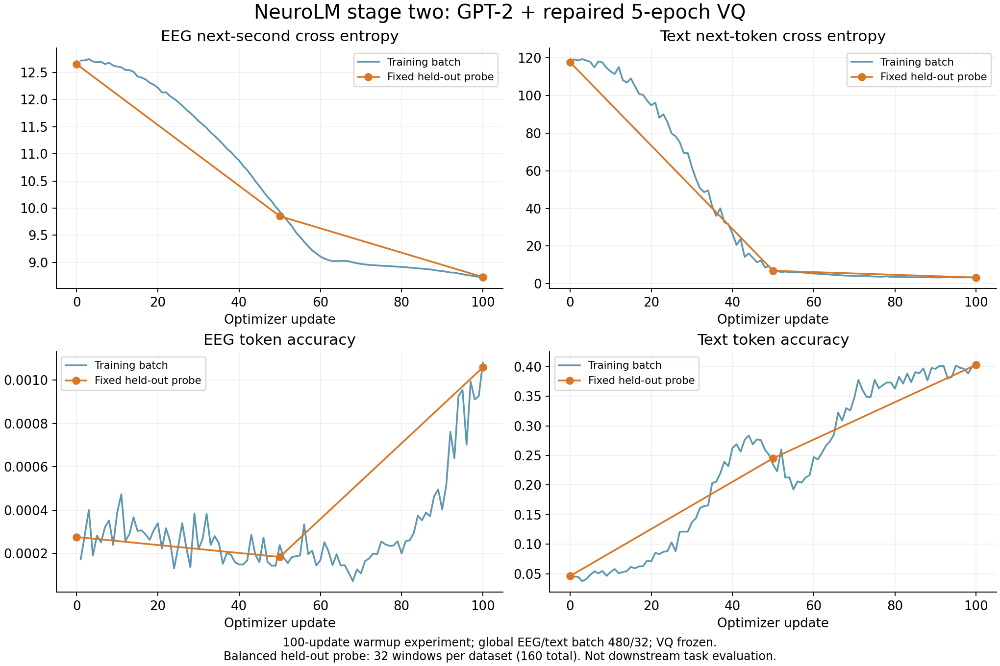

# 阶段二最小实验：GPT-2 + 修复后的五 epoch VQ

用户指定执行顺序：先完成本次阶段二 100 次优化器更新，再运行 1024×64、dead-code patience 50 的五 epoch VQ 对照。本次不是完整阶段二训练，也不据此宣称下游任务效果。

## 模型与数据

- VQ：`vq-fixed-e5-20261108-r1/run/checkpoints/VQ/ckpt-4.pt`，4485 步、5 完整 epoch、8192×128、encoder/decoder 12/3，hidden 768。
- VQ 文件 SHA-256：`546e07e0b455b15ef9374a96bc77dead226bba8d00afa6e738a625fbb266de07`。
- GPT-2：`openai-community/gpt2`，固定 revision `607a30d783dfa663caf39e06633721c8d4cfcd7e`。本地加载完整参数，保留作者扩展词嵌入和输出层逻辑。权重通过镜像取得，并对照 [官方权重 SHA-256](https://huggingface.co/openai-community/gpt2/blob/607a30d783dfa663caf39e06633721c8d4cfcd7e/model.safetensors) 核验为 `248dfc3911869ec493c76e65bf2fcf7f615828b0254c12b473182f0f81d3a707`。
- 冻结 VQ encoder 和量化器；训练 GPT-2 与作者的 EEG 通道位置嵌入。输出类别数 58496（50304 文本 + 8192 EEG）。
- 五数据集训练窗口共 459656；沿用已有训练分片和 OpenWebText uint16 bins。
- 独立固定验证探针：TUAB val、TUEV processed_eval、HMC/Workload/TUSL eval 各随机抽取 32 个窗口，seed 20261108，共 160。核对其文件名不属于训练清单。TUAB/TUEV 从原 EDF 使用与训练数据相同的 60 Hz 预处理重建；另三数据集保留已验证信号。
- 这是按数据集均衡的小型验证探针，不是按总体分布加权的完整验证集。原始 EEG 不上传 GitHub。

## 训练协议

2 节点 × 8 H20；每卡 EEG/text batch 30/2，全局 480/32，block size 1024，bf16。作者 EEG 下一秒目标（按通道数移位），padding 和最后一秒忽略；EEG CE + text CE，训练保留作者各 rank CE 均值，验证按全局有效 token 加权。

学习率峰值 6e-4、最小 6e-5、weight decay 0.1、AdamW betas 0.9/0.95、gradient clip 1、seed 42。保留 20 epoch / 2 warmup epoch 调度，每 epoch 957 步；`--max_updates 100` 在第一 epoch 中途停止。因此 100 步结果仍处在 warmup，不等价于完整阶段二收敛。关闭 W&B 和 compile。

第 0、50、100 步测同一批 160 个 EEG 窗口，以及固定 131072 个文本 token。保存逐步 EEG/text loss、accuracy、梯度范数、lr 和 16 rank 的输入顺序。结束时检查 encoder/量化器哈希不变、GPT block 参数确实改变，并保存部分 epoch checkpoint。

CPU 集成检查使用真实 VQ/GPT-2 做了一次真实优化器更新，验证目标移位、忽略位置、所有可训练参数有限梯度和冻结状态。该检查的裁剪训练样本及随机文本仅验证执行链路，其 loss 不用作模型质量指标。

## 修复与运行入口

补丁 `0019-bounded-stage-two-with-frozen-repaired-vq.patch` 基于 0017/0018 VQ runtime 加作者原始 `train_pretrain.py`。`scripts/apply_pretrain_min100.py` 验证基线和补丁哈希，在新目录构建 28 文件 runtime。补丁应用和最终文件哈希已通过核验。

第一次提交 `train-1713079633157303040` 在任何训练更新前退出：原入口 `utils` 导入了工作镜像不含的下游 `tiktoken`。改为复用已有独立 `vq_scheduler`（同一调度实现），并在节点 preflight 增加真实入口导入检查。失败目录 r1 保留；重新提交使用独立 r2 目录。

当前运行目录：`/mnt/cfs-omni/lhy/neurolm-reproduction/pretrain-min100-20261108-r2`。

操作入口：`scripts/check_pretrain_min100.py`（Notebook STS，凭证仅留服务器），启动脚本 `scripts/run_pretrain_min100.sh`。监控与曲线导出 `scripts/observe_pretrain_min100.py`，tmux socket `/tmp/clawdbot-tmux-sockets/neurolm-pretrain-min.sock`、session `pretrain-min`。TI-ONE 执行训练，tmux 只负责持久监控、打印和导出。

本脚本的 bounded 分支仅用于这次 100 步实验；部分 epoch checkpoint 不能未经适配就作为作者完整 epoch 恢复点。未启动完整 20 epoch 训练。

## 最终结果

修复版任务 **`train-1713081519888795392` / SUCCEED**。两个工作节点退出码均为 0；100 行逐步日志和 16 个 rank 的输入记录核验通过。冻结 EEG encoder、目标 encoder、量化器的哈希完全不变；GPT block 参数哈希改变。最终 checkpoint SHA-256：`84e3b11566c2567ba3d8826b8f919d9cd7fe7629c52d34b6d22808273e280ce5`。

| 固定验证探针 | 第 0 步 | 第 50 步 | 第 100 步 |
| --- | --- | --- | --- |
| EEG CE | 12.64877 | 9.85276 | **8.73188** |
| 文本 CE | 117.81937 | 6.81131 | **3.20005** |
| EEG token accuracy | 0.0276% | 0.0184% | **0.1059%** |
| 文本 token accuracy | 4.6005% | 24.5346% | **40.3366%** |

验证探针有 21728 个有效 EEG 目标、131072 个文本目标。VQ 目标覆盖 4303 个码、perplexity 3124.41，三个评估点完全相同。前/末 10 步训练均值：EEG CE 12.68101 → 8.77734；文本 CE 117.25533 → 3.27901。所有 loss 和梯度检查通过。

最小实验验证了阶段二能够更新、独立探针 CE 下降及 VQ 冻结正确；EEG 准确率仍低，不能据此宣称脑电表示或下游分类已达到要求。100 步仍在 warmup 内，最终 lr 3.1051e-5。

### 文本初始 loss 异常的定位

在验证文本 bin 的同一段 1024 token 上，独立 CPU fp32 诊断得到：原始 GPT-2 CE **2.90855**，按作者代码扩展至 58496 个输出类别后 CE **117.92794**，原 50257 类的 logits **逐元素完全不变**。原类别 logits 均值 -113.446、新类别均值 0.00492；新增类别 logsumexp 在 95.21% 的位置超过原词表，造成初始分布失衡。

这轮保持作者初始化方式，未在训练中途修改。前期文本 loss 的大幅下降包含对上述词表扩展失衡的修正，不能全部解释为 EEG 学习效果。诊断见 `gpt2_expansion_diagnostic.json`，不与 131072 token 的完整验证均值混用。

结果和 22 文件 SHA 清单见 `results/pretrain_min100_20261108/`。下载归档 SHA-256：`f8894cf4fd9c256833a699f45966b7f3d3d227d04c286405e44357f52e964439`。平台最终状态和附加词表诊断单独保留。训练完成且核验通过后，才提交后续紧凑 VQ 对照任务 `train-1713086037633018624`。
