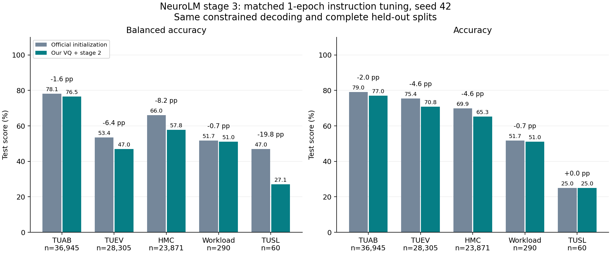

# NeuroLM 五数据集复现结项报告

结项日期：**2026-11-09（Asia/Shanghai）**。项目状态：**已完成并归档**。

按用户确认，以本次五数据集的端到端复现、训练和评估交付物作为完成范围。链路为：数据准备 → 自训 VQ → GPT-2 初始化的阶段二预训练 → 阶段三指令微调 → 官方初始化基线对照 → 独立审计 → GitHub 归档。

“完成”指上述实验链路和结果交付完成。保留实测结论：本轮五项测试平衡准确率均低于官方初始化基线。论文的 25,000 小时预训练语料、包含 SEED 的六任务、5 epoch 指令微调与三 seed 结果不属于本次结项范围，未作为已达成结果。

## 完成信息

| 阶段 | 完成配置 | 证据 |
| --- | --- | --- |
| 数据准备 | TUAB、TUEV、HMC、Workload、TUSL；459,656 个训练窗口；文本使用 OpenWebText | [数据清单](DATASETS.md)、[阶段二输入核验](../results/pretrain_full20_20261109/final/preflight.json) |
| VQ | 采用完成 5 epoch 的 8192×128 权重；用于后续冻结编码器和目标量化器 | [权重元数据与哈希记录](pretrain_stage2_log.md) |
| 阶段二 | GPT-2 初始化；2 节点 × 8 H20；20 epoch、19,140 次更新；全局 EEG/text batch 480/32 | [训练记录与曲线](pretrain_stage2_log.md) |
| 阶段三 | 完整恢复新阶段二模型；冻结 EEG 编码器；2 H20；1 epoch、seed 42；7,182 microstep、898 次更新 | [训练与权重审计](stage3_new_pretrain_comparison.md) |
| 对照评估 | 新旧模型统一选项约束解码，各 201,240 条完整 val/test 预测，合计 402,480 条；非法答案 0 | [新模型审计](../results/stage3_new_pretrain_20261109/final/audit-new.json)、[官方模型审计](../results/stage3_new_pretrain_20261109/final/audit-official.json) |

阶段二任务 `train-1713134905275320064`，阶段三任务 `train-1713786859836016384`，归档终态均为 `SUCCEED`，对应节点/worker 退出码均为 0。阶段三训练与两模型评估合计 38 分 04 秒，于 2026-11-09 14:27:05（北京时间）完成。

这些是已归档的实测运行信息；本次结项整理未重新提交训练或执行服务器状态探测。

## 测试结果

同一五任务、1 epoch、seed 42 指令微调协议下，与官方初始化基线比较。BA 为平衡准确率。

| 数据集 | 官方基线 BA | 新模型 BA | 差值（百分点） |
| --- | ---: | ---: | ---: |
| TUAB | 78.11% | 76.52% | -1.59 |
| TUEV | 53.43% | 47.00% | -6.43 |
| HMC | 66.03% | 57.80% | -8.22 |
| Workload | 51.72% | 51.03% | -0.69 |
| TUSL | 46.97% | 27.15% | -19.82 |



准确率、F1、kappa、AUC、全部验证集结果及小样本限制见[完整评估报告](stage3_new_pretrain_comparison.md)。本次是单 seed 实验，TUSL test 仅 60 例；结果保留原值，不因结项而改写。

## 最终权重

权重保存在腾讯云共享盘，路径和校验值如下。代码、配置、报告、曲线及聚合审计记录发布到 GitHub；EEG 样本、完整预测行、模型文件和凭证保持原有存放位置。

### VQ

```text
/mnt/cfs-omni/lhy/neurolm-reproduction/vq-fixed-e5-20261108-r1/run/checkpoints/VQ/ckpt-4.pt
SHA256: 546e07e0b455b15ef9374a96bc77dead226bba8d00afa6e738a625fbb266de07
```

### 阶段二 NeuroLM-B

```text
/mnt/cfs-omni/lhy/neurolm-reproduction/pretrain-full20-20261109-r1/run/checkpoints/NeuroLM-B/ckpt.pt
SHA256: b13d1acdea4ed32fa1a3e6c7163c6fde6a03857eda131e36b10cc1380a3c5353
```

### 阶段三 instruction-B

```text
/mnt/cfs-omni/lhy/neurolm-reproduction/stage3-new-pretrain-20261109-r1/train/checkpoints/instruction-B/ckpt.pt
SHA256: 39a53023b4d6b77b5264ec9d7461f202ab023938a0d9804ead493115a2bc50af
```

最后 20 个阶段三日志点平均 instruction CE 为 0.123337、text CE 为 3.065316；这是 rank-0 microbatch 的日志均值，不是下游评估指标。

## 曲线与复查入口

- [阶段二 20 epoch 训练曲线](../results/pretrain_full20_20261109/final/monitor/pretrain_curves.png)
- [阶段三完整训练曲线](../results/stage3_new_pretrain_20261109/final/monitor/training_curves.png)
- [新旧模型对比图](../results/stage3_new_pretrain_20261109/final/monitor/comparison.png)
- [机器可读对照结果](../results/stage3_new_pretrain_20261109/final/comparison.json)
- [阶段三 46 项最终证据的 SHA-256](../results/stage3_new_pretrain_20261109/final/sha256.json)
- [阶段三启动脚本](../scripts/run_stage3_new.sh)与[TI-ONE 配置](../experiments/stage3_new_pretrain_tione_20261109.json)

GitHub 仓库：[YYholitel/NeuroLM-Reproduction](https://github.com/YYholitel/NeuroLM-Reproduction)。结项前完整结果提交为 `6346157`；结项状态更新记录于后续提交。

已完成的 tmux 会话保留为日志查看入口：阶段二 `pretrain_neurolm`，阶段三 `stage3_neurolm`。阶段三 socket 为 `/tmp/clawdbot-tmux-sockets/neurolm-stage3.sock`。
