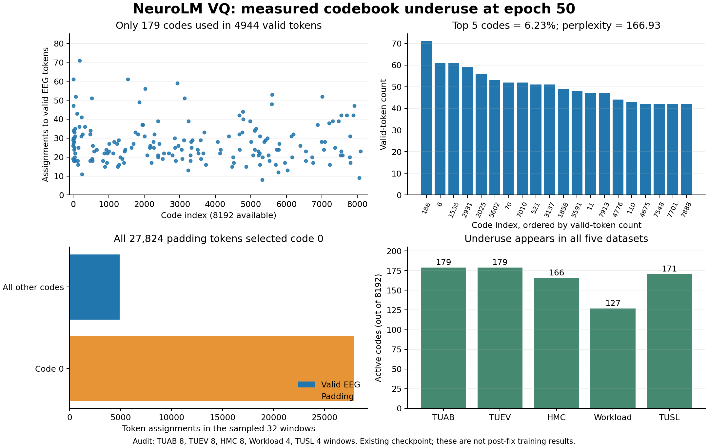

# VQ 码本使用不足：实测原因与修复

2026-11-08。对象：`vq-five-full-20261107-r1` 的第 50 epoch checkpoint；五数据集 459,656 个训练窗口。本次只做 CPU 诊断、独立代码修复和测试，**未启动新的 GPU 训练**。原运行代码、数据和 checkpoint 保留不动。

## 结论

8192 个码在训练末尾实际只使用约 179 个，属于严重使用不足。不过，“大部分真实 EEG 被挤进前 5 个码”不符合实测。32 个分层抽样窗口的 4944 个有效 token 中，前 5 个码仅占 6.23%，perplexity 为 166.93。

已证实的代码问题是 **padding 参与了码本初始化、EMA 和承诺损失**，且没有死码重置。全量训练窗口的 token 位置中，padding 占 81.3889%。本次抽样的 27,824 个 padding token 全部映射到码 0。旧 checkpoint 的 EMA 统计里，最大码占 81.4764%。这些证据强烈支持 padding 污染是主要原因之一；修复后实际恢复多少，仍需短程训练对照验证。

不能从现有证据推断作者使用了未公开的 trick，也不能把问题直接归咎于“五数据集太小”。本次发现的是可复现的数据流问题。

## 实际打印

实际使用 `get_codebook_indices`，再用整数 `torch.bincount` 统计（避免浮点直方图的分箱歧义）。随机种子 20261108，TUAB/TUEV/HMC 各 8 窗、Workload/TUSL 各 4 窗。读取前核验了部署源码哈希。

```text
beta                         = 1.0
ema_decay                    = 0.99
declared_epsilon              = 1e-5
codebook_requires_grad       = False
codebook_in_optimizer        = False
initial_kmeans_tokens        = 32768
initial_nonempty_clusters    = 1376 / 8192
initial_top32_cluster_share  = 83.8745%
epoch10_to50_changed_rows    = 191 / 8192  (L2 difference > 1e-6)
epoch50_unique_weight_rows   = 1601 / 8192
valid_tokens                = 4944
valid_active_codes          = 179 / 8192 = 2.1851%
valid_perplexity            = 166.9286
valid_top1_share            = 1.4361%
valid_top5_share            = 6.2298%
padding_tokens             = 27824
padding_active_codes       = 1 (code 0)
padding_code0_share        = 100%
```

前 10 个有效码的 `码号:次数`：

```text
186:71, 6:61, 1538:61, 2931:59, 2025:56,
5602:53, 7010:52, 70:52, 3137:51, 521:51
```

首个 TUAB 窗口前 32 个真实 token ID：

```text
1149,4069,5602,3328,6726,5731,7888,17,1,3585,245,1126,6,4069,1638,7208,
7304,591,5146,7474,58,2162,2025,57,6884,7010,7526,2160,531,7474,17,2959
```

| 数据集 | 有效 token 数 | 活跃码 | Perplexity | Top-5 占比 |
|---|---:|---:|---:|---:|
| TUAB | 1840 | 179 | 164.31 | 6.09% |
| TUEV | 920 | 179 | 156.19 | 6.85% |
| HMC | 960 | 166 | 125.89 | 12.08% |
| Workload | 304 | 127 | 108.94 | 9.87% |
| TUSL | 920 | 171 | 135.56 | 10.54% |

样本数不同，这个表不能用来给数据集质量排名。原训练最后 100 个更新的有效 token 统计同样只有 179 个活跃码，因此使用不足并非仅由此次小样本统计造成。



## 为什么会这样

1. **码本本来就是 EMA 更新。** 码本权重不在 AdamW 里，图中原称 “Codebook Loss” 的量实际是 `beta * MSE(stop_gradient(quantized), encoder_output)`，即承诺损失。给码本另设 AdamW 学习率不会改变当前 EMA 路径。β 已是 1.0，无需再从 0.25 调到 1。
2. **padding 在三个环节进入了码本学习。** 注意力屏蔽和日志中的有效 token 过滤，并没有把有效掩码传给量化器。首个 rank 的 32768 个位置都进入 k-means，只有 1376 个簇非空。后续的 EMA 计数、中心更新和承诺损失也使用所有位置。
3. **没被选中的码无法恢复。** 原分支对零计数的码保留旧向量；`reset_cluster_size` 只清空统计，没有替换码向量。已部署版本的 k-means 初始化已有 rank-0 广播，不能把它误诊为尚未修复的跨卡初始化不一致。
4. **loss 的分母会掩盖问题。** 旧重建损失虽然把 padding 的重建置零，却仍除以全部 1024 个位置。有效比例约 18.61%，让数值被压低且随窗口长度变化。承诺损失也被大量容易预测的 padding 稀释。重建下降因此不等于码本容量得到充分使用。

当前使用的是“每 batch 归一化质心的 EMA”，不是累计 sum/count 后相除的另一种 EMA。声明的 epsilon 只用于未调用的旧 `weight_update` 方法；实际分支用空计数保护避免除零。此处未发现 epsilon 引起 NaN 的证据。

## 已实现的修复

补丁 [0017](../patches/0017-vq-valid-token-ema-and-dead-code-reset.patch) 修改四个文件：`model/norm_ema_quantizer.py`、`model/model_vq.py`、`train_vq.py`、`vq_monitor.py`。

- 明确传入有效 token 掩码，只有有效向量参与初始化、量化距离、EMA 和承诺损失。padding 输出为零，索引零仅作占位，统计仍必须使用掩码。
- 初始化候选来自所有 rank 的有效向量，默认每 rank 最多 2048 个（若码本大小需要更高下限则提高上限），由 rank 0 执行 k-means 并广播。16 rank 通常可汇集 32768 个候选。
- 加入可配置死码策略：连续 100 次训练前向未被全局有效 token 使用，每 50 次检查一次；从当前有效候选池抽取替代向量并广播。`--vq_dead_code_patience 0` 关闭重置。100/50 是本次实验起点，**不是论文超参或已验证的最优值**。
- 保留 β=1.0、decay=0.99 和原归一化 EMA 算法。EMA 距离/归约在 FP32 下执行，用 bincount/index_add 代替庞大 one-hot 矩阵。
- 重建和承诺损失按有效元素计算；DDP 根据全局有效数量加权，EEG 对抗损失也按全局有效 token 加权。新日志附带 `reconstruction_padded_mean` 作为旧分母的比较指标，以及实际 `dead_code_resets`。
- eval 不初始化或修改码本/统计；checkpoint 记录新策略和 loss 口径，拒绝静默续接旧口径 checkpoint。

有效分母会改变重建与对抗目标的相对强度。对同一批预测，新旧重建指标有明确比例关系，但不能直接拿新训练的 loss 数值与旧图的 0.08 比大小。`reconstruction_padded_mean` 保留旧分母，不代表两个模型的输出已经相同。

死码替换参考了 [SoundStream 第 III-C 节](https://storage.googleapis.com/gweb-research2023-media/pubtools/6245.pdf) 使用当前 batch 向量恢复闲置码的思路。本补丁采用连续未使用次数，未照搬其 EMA 计数阈值 2。[VQ-VAE 原文 Appendix A.1](https://arxiv.org/html/1711.00937v2)介绍了 EMA 更新；实际 NeuroLM 分支以[冻结版本代码](https://github.com/935963004/NeuroLM/blob/0cda9876d8ce6ee07ed0c43eee5e9a6f5c24b177/model/norm_ema_quantizer.py)及本次部署审计为准。

## 验证与复用

[测试记录](../results/vq_codebook_fix_checks_20261108.json)包含源码前后哈希、补丁哈希及四组真实 CPU 测试结果：

- 原实现反例：同一组有效向量，添加 padding 后承诺损失从 0.1252166 变成 0.0980619，EMA 权重也变化。
- 修复后：改变/追加 padding 不改变有效分配、初始化、EMA、承诺损失与有效梯度；padding 梯度为零；外层 bf16 autocast 不改变量化器 FP32 结果；eval 不改状态。
- 双 Gloo 进程：有效候选跨 rank 初始化、重置同步、全局加权梯度正确；单个 rank 无有效 token 仍能参与；全局全空批次被拒绝；单 rank eval 不等待其他 rank。
- 实际小型 VQ：768 hidden、1 层 encoder/decoder、16 个码的 CPU 前向/反向和 AdamW 更新通过，梯度有限；码本不在优化器中；固定 probe 保留状态；CLI 与日志字段通过。

补丁已在一份基准副本上实际应用，并逐文件核对产物哈希。用下面的脚本生成**新目录**，它会验证基准、规范换行并应用补丁：

```bash
python scripts/apply_vq_codebook_fix.py \
  --source-runtime /path/to/vq-five-full-20261107-r1/code \
  --output-runtime /path/to/new-vq-code
```

腾讯端独立修复副本：`/mnt/cfs-omni/lhy/neurolm-reproduction/vq-codebook-fix-20261108-r1/code`。

下一次验证应从新输出目录开始，固定数据和随机种子，对比“掩码/分母修复，重置关闭”和“同样修复，重置开启”。先观察 100–500 个更新并使用足量独立验证样本；确认有效码数、perplexity、重置次数及验证重建趋势，再延长到 1–5 epoch。不要只因重置瞬间增加了码数就宣布恢复。

**尚未验证：**16 张 H20/NCCL 下的运行性能和训练曲线恢复。现有 TemporalConv 的 GroupNorm 还跨 token 维度计算统计，本补丁没有更改编码器结构；量化器的 padding 不变性不代表整个编码器对 padding 长度完全不敏感。不能把本次功能测试描述成“全量训练已经修好”。

完整原始聚合结果：[审计 JSON](../results/vq_codebook_audit_20261108.json)；全 32 窗 token ID 与掩码保留在服务器 `vq-codebook-fix-20261108-r1/audit/token_indices.npz`，未把 EEG 波形写入 Git。
