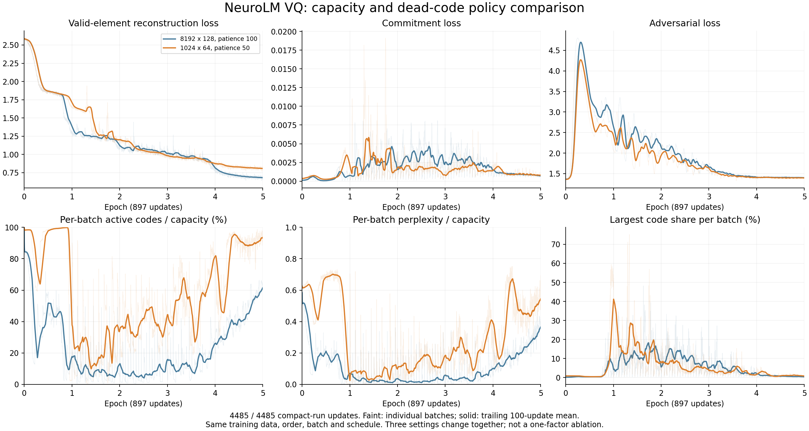
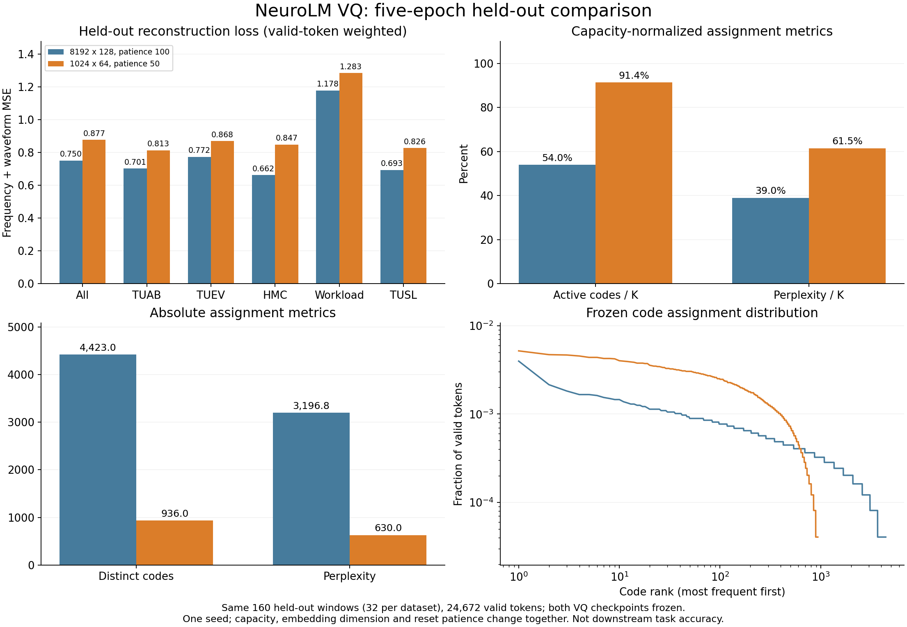

# VQ 容量与死码策略的五 epoch 对照

按用户指定顺序，先完成修复后 8192×128 VQ 的阶段二 100 步最小实验，再执行本次实验。提交入口会检查阶段二完成标记、完整性核验及两个节点退出码；未满足时不能提交。

## 固定条件与改动

本次从头初始化 **1024×64** 码本，连续 **50 步**未用的码在每 **50 步**检查时重置。基线为 8192×128、patience 100、interval 50。检查间隔原本已经是 50；本次改变的是死码判定所需的连续未使用步数。三个设置同时改变，不能据此单独归因于容量、维度或重置策略。

其余沿用已完成的五 epoch 基线：五数据集 459656 训练窗口，两个 8×H20 节点，全局 EEG/text batch 512/128，encoder/decoder 12/3、hidden 768，EMA .99、β=1、seed 42、50 epoch / 5 warmup 调度，4485 步恰好五完整 epoch，峰值/最小 LR 5e-5/1e-5。W&B 关闭。两次模型结构不同，因此不能要求初始化权重逐字节相同；数据清单和全部 16 rank 的输入顺序必须完全一致。

补丁 `0020-configurable-vq-codebook-capacity.patch` 只将 `train_vq.py` 的码本容量、维度开放为 CLI，并将 decoder 输入维度与之关联。默认仍是 8192×128；checkpoint 的 `vq_options` 保存容量和维度，禁止不同配置隐式恢复。旧 8192×128 checkpoint 不加载到本次模型。脚本 `apply_vq_capacity.py` 验证原 runtime 和补丁，输出全新 runtime。

已完成的阶段二最小脚本明确锁定 8192×128，使用 58496 类输出层。如果以后选用本次 1024 码权重，必须按 checkpoint 构建 50304+1024=51328 类输出层并核对 token 偏移，不能只替换文件路径。当前未将紧凑权重接入阶段二，也未启动完整 20 epoch 预训练。

真实 CPU 优化器/严格 checkpoint 回载检查使用 1024×64、hidden 768、缩小为 1/1 层的测试模型，确认 padding 不进入码本计数、梯度有限、量化器评估不变、使用率分母为 1024。实际训练仍是 12/3 层。

## 观测协议

记录逐步三项 loss、每 batch 活跃码比例、perplexity、perplexity/K、最大码份额、重置数及 epoch 末 100 步指标。原基线中已有的 512/128 阈值只是历史诊断提示，不作为本实验自动通过标准。更小的容量自然更容易获得较高使用率，必须同时看绝对 perplexity、重建误差和集中度。

最终对同一组 32 个训练诊断样本、4944 个有效 token 做冻结 checkpoint 评估，与基线最终权重比较。该组不是独立验证集，不据此宣称下游准确率提升。两轮数据顺序的 SHA-256 完全一致才标记对照核验完成。

另外复用阶段二已建立的 **160 个独立验证窗口**（五数据集各 32 个），通过 `audit_vq_heldout_probe.py` 分别评估两轮最终 checkpoint，记录有效 token 加权的频域/时域重建误差、commitment 和码本分配，并保存逐样本结果。`compare_vq_heldout_probe.py` 先评估已完成的基线，再等待紧凑模型五 epoch 完成后评估；整个过程冻结模型、确认量化器状态不变。这个均衡小探针不等同于完整验证总体或下游任务指标。

## 运行与产物

隔离根目录：`/mnt/cfs-omni/lhy/neurolm-reproduction/vq-compact-e5-20261108-r1`。提交和状态入口 `scripts/check_vq_compact_e5.py`；TI-ONE 配置见 `experiments/vq_compact_e5_tione_20261108.json`。

任务已提交：`train-1713086037633018624`，名称 `neurolm-vq-compact16-e5-20261108-r1`。提交时阶段二 100 步任务已 SUCCEED，冻结状态、权重更新、数据和产物检查全部通过。tmux 会话为 `vq-compact`，socket `/tmp/clawdbot-tmux-sockets/neurolm-vq-compact.sock`。

`scripts/observe_vq_compact_e5.py` 在 tmux 中监控、绘制真实日志对比，完成后核验 4485 步、运行冻结审计、导出哈希清单。训练由 TI-ONE 工作节点执行。失败即报告，不自动提交完整阶段二或额外实验。

## 最终结果与选择

平台最终状态 **SUCCEED**；两节点退出码均为 0，完成 4485 次更新和 5 个完整 epoch。全部 16 个 rank 的完整输入顺序 SHA-256 与大码本基线完全相同。最终紧凑 checkpoint SHA-256：`65ca5f11761c37cac8b9817550b5f0001db5aae40ca75215826fe1f9e22a0418`。

**本次不采用紧凑配置替换修复后的 8192×128 VQ。** 到第 5 epoch，紧凑模型已经从中途的严重集中分配中恢复；但更高的容量使用比例伴随着更大的重建误差。五数据集独立探针的总体误差增加 **16.87%**，且五个数据集均变差。保留修复后的大码本权重作为后续训练候选，不继续缩至 512，也没有将紧凑权重接入完整阶段二。

### 同一独立探针：160 窗口、24672 个有效 token

| 指标 | 8192×128，patience 100 | 1024×64，patience 50 |
| --- | ---: | ---: |
| 总重建误差 | **0.750199** | 0.876764 |
| 频域重建误差 | 0.218606 | **0.214026** |
| 时域重建误差 | **0.531592** | 0.662738 |
| 活跃码 | 4423 / 8192 | 936 / 1024 |
| 活跃比例 | 53.99% | 91.41% |
| 绝对 perplexity | 3196.76 | 630.01 |
| perplexity / K | 39.02% | 61.52% |

紧凑配置的频域误差略降，但时域误差增加，导致总误差上升。不同容量的使用比例和绝对码数不能混为同一指标。

| 数据集（各 32 窗口） | 大码本重建误差 | 紧凑码本重建误差 |
| --- | ---: | ---: |
| TUAB | **0.701291** | 0.812890 |
| TUEV | **0.772497** | 0.868480 |
| HMC | **0.661751** | 0.847189 |
| Workload | **1.177917** | 1.283108 |
| TUSL | **0.692771** | 0.825940 |

该结果限于一个随机种子和这个均衡小探针；容量、维度和 patience 同时改变，不能归因于其中单项。没有测下游准确率。

### 训练末段与固定训练诊断

末 100 步重建均值：大码本 **0.682675**，紧凑码本 **0.808879**；commitment 分别 0.000704 / 0.000802，对抗 loss 1.400633 / 1.394184。紧凑末 100 步的单 batch 活跃码最小 898、中位数 962；perplexity 最小 415.02、中位数 557.96，已不处于早期几乎只用几个码的状态。末 100 步并集覆盖全部 1024 个码，其合并 perplexity 为 606.41。

相同 32 个训练诊断样本上，大码本/紧凑码本的重建误差为 **0.683196 / 0.822914**，活跃码 2432 / 772，perplexity 1881.44 / 555.17。冻结审计均确认量化器状态不变。

## 产物核验与保留

结果目录 `results/vq_compact_e5_20261108/` 保存完整训练日志、五 epoch 汇总、配置、16 rank 输入顺序哈希、GPU 采样、固定训练审计和最终 checkpoint SHA。`supplement/` 保存独立探针逐样本结果、平台最终状态及 GPT-2 teacher embedding 一致性检查（最大差值 0，证明 VQ 的文本 teacher 与阶段二 GPT-2 初始嵌入相同）。

- 主归档 24 文件 SHA 清单核验通过；归档 SHA-256：`25cdfbe0b35ea0365e762509a2cc9cd7cc683d06fe8fe2d616ab9ae7c36a8454`。
- 补充归档 6 文件 SHA 清单核验通过；归档 SHA-256：`80c18a1b0a908f168df5b0f2e2608007357345bb7e28848468fa111b8d8463dd`。
- 模型权重、EEG 数据及凭证均未上传 GitHub。tmux 的监控和验证窗口保留完成日志；本轮 GPU 训练已经结束。
