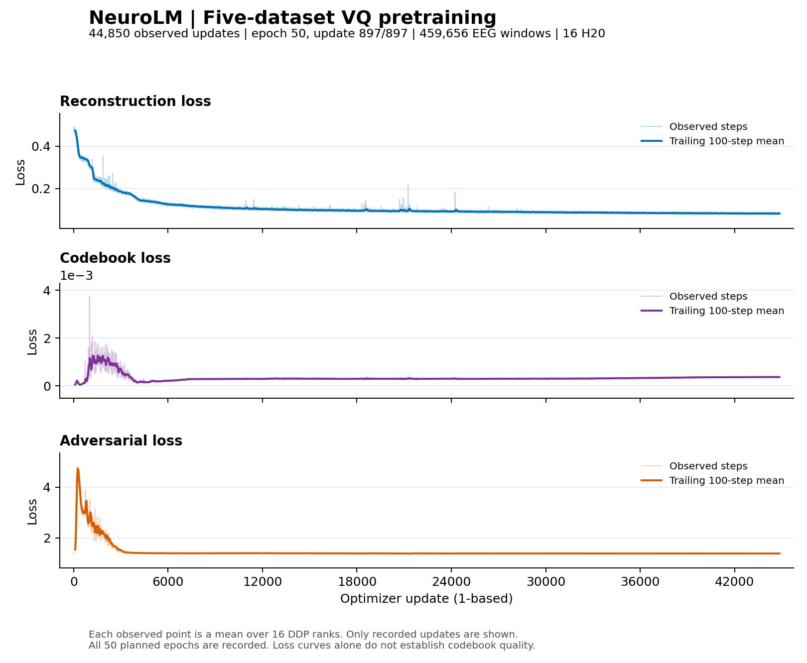

# 五数据集全量 VQ 预训练（2026-11-07）

用户明确指定使用现有五个数据集做全量预训练。本次使用各数据集已有 **train** 划分，保留验证集和测试集；不是论文的 25,000 小时预训练语料复现。

## 冻结输入

| 数据集 | 训练窗口数 | 通道 × 采样点 | 工频处理 |
| --- | ---: | --- | --- |
| TUAB | 298,511 | 23 × 2,000 | 原始 EDF 重新处理，60 Hz |
| TUEV | 68,270 | 23 × 1,000 | 原始 EDF 重新处理，60 Hz |
| HMC | 91,248 | 4 × 6,000 | 保留现有信号，50 Hz |
| Workload | 1,508 | 19 × 800 | 保留现有信号，50 Hz |
| TUSL | 119 | 23 × 2,000 | 保留现有信号，60 Hz |
| 合计 | **459,656** | | |

窗口长度累加约 **1,686.423 小时**，包含既有滑窗重叠，不代表去重录制时长。每份 pickle 仅保留 `X` 和 `ch_names`，不使用类别标签。`X` 为 float32 微伏值，`PickleLoader` 中执行 `/100`。与先对 float64 除以 100 再转 float32 的旧路径可能有浮点舍入差异。未裁剪异常幅值、未额外去均值；部分原始记录的伪迹和边缘瞬态仍存在，不能把格式校验通过解释为所有样本信号质量理想。

源目录：`nccserv0:/data/lihy/NeuroLM/datasets`。源计划保存在 `/data/lihy/NeuroLM/outputs/vq-five-full-20261107-r1/source_plan.json`，计划 SHA256：`d83aba055dfc45a6b89cf1860ca8fad272fd68527a7866c3d3e11ea278bdbaa5`。计划记录训练文件成员、EDF/标注路径及大小和修改时间，分片处理前校验源文件未改变。

源服务器空间不足以保留第二份全量数据，因此在源端 CPU 处理，通过 COS 直传到腾讯，再写入 CFS，不在本机落地 EEG。初始 SSH 转发路径的实测吞吐较低，已切换为服务器间直传。为避免 CFS 的小文件写入瓶颈，接收端保存未压缩 tar 分片和样本偏移索引；包内仍是独立 pickle。加载器缓存少量分片句柄，读取指定偏移的 pickle，后续张量变换沿用原代码。旧下游 pickle 不覆盖。

文本使用已生成的完整 OpenWebText `train.bin`（18,071,164,978 字节）及 `val.bin`（8,869,212 字节）。预检核对完整 SHA256。GPT-2 冻结词嵌入复用已验证资产；VQ 模型从头初始化，不继承 4 步诊断检查点。

## 训练配置

任务名：`neurolm-vq-five-full16-e50-20261107-r1`。配置见 [TI-ONE JSON](../experiments/vq_five_full_tione_20261107.json)，启动器见 [run_vq_five_full.sh](../scripts/run_vq_five_full.sh)。

- 两节点，每节点 8 张 H20，DDP 共 16 个进程。
- 每进程 EEG batch 32、text batch 8；全局分别 512、128，累积步数 1。
- encoder 12 层，两个重建 decoder 各 3 层；hidden 768，码本 8192 × 128。
- 50 epochs，warmup 5，学习率 5e-5 → 1e-5，AdamW beta 0.9/0.999，weight decay 1e-4。
- 每 epoch 897 次更新，共 44,850 次；warmup 4,485 次。沿用 `drop_last=True`，每 epoch 使用 459,264 个样本位置，随机打乱后尾部不满批的数据丢弃。
- W&B 关闭；每步保存全局平均 loss，stdout 首 20 步及其后每 10 步打印。检查 loss/梯度有限，不要求随机批次重建 loss 每步下降。
- 每 epoch 原子更新 `ckpt.pt`，每 10 epoch 另存检查点。
- 每个实际训练节点每 5 秒记录 8 张 GPU 的利用率、显存占用、功耗和温度；输出为 `run/node-0/gpu_metrics.csv` 和 `run/node-1/gpu_metrics.csv`。监控随该节点训练进程退出，不将开发机的 GPU 指标当作训练节点指标。
- 每 epoch 写入 `run/epoch_metrics.jsonl`：三个 loss 的均值及前/后 100 步均值、LR、对抗系数、有效 EEG token 的码本覆盖率、perplexity 和最常用码的占比。分别统计整轮与最后 100 次更新，避免整轮覆盖率掩盖后期退化。
- 沿用 smoke 的两个固定诊断 pickle，第一步训练更新后保存本次运行基线，此后每 epoch 在同一数据上评估。评估保存和恢复量化器统计缓冲区及 RNG，不改变训练参数或训练数据顺序。smoke 的 2.86 只作参考，不能与输入组成、窗口长度不同的全量 batch loss 直接作早停判定。
- 第 1、5、20、25、30、50 epoch 另存 `run/review_checkpoints.jsonl`；任何其他 epoch 出现检查标记也会写入。第 5 epoch 校验最后一步 LR 为 5e-5。第 20–30 epoch 检查最近五轮固定诊断与训练尾窗是否都缺乏改善。
- NaN/Inf loss 或梯度立即终止。少于 512 个近期有效码、低于 128 的 assignment perplexity、五轮改善低于 0.5% 等仅为检查提示，不是论文验收标准，也不会单独触发自动停止；应结合固定诊断和持续趋势判断。双进程 CPU 小模型验证确认新增监控前后 loss/梯度完全相等、使用率排除 padding、评估不修改 state_dict/RNG；这项验证不代替实际 16 GPU 训练检查。

独立运行根目录：`/mnt/cfs-omni/lhy/neurolm-reproduction/vq-five-full-20261107-r1`。

## 执行与状态证据

[流水线脚本](../scripts/vq_five_full_pipeline.py) 已启动为腾讯开发机上的独立进程：等待所有数据包到达，执行 [完整预检](../scripts/preflight_vq_five_full.py)，使用 Notebook 临时 STS 身份预检并提交同名任务，确认平台状态和首批真实训练指标。临时凭证只在远端内存使用，调用后删除临时 Notebook 内核。按任务名去重，避免重复提交。

**准备、提交、排队和实际训练是不同状态。** 以远端 `pipeline_state.json`、`submission_readback.json`、`run/metrics.jsonl` 和本次 TI-ONE API 查询为准；不能仅凭脚本已部署报告 GPU 训练已经开始。

单 pickle 版本的诊断：五套数据共 1,170 个样本完成传输，每套抽查 12 个，真实 `PickleLoader` 的六个输出张量均有限，`X/100` 精确符合新输入，文本验证集哈希一致。结果见 [诊断 JSON](../results/vq_five_diagnostic_preflight_20261107.json)。[分片版本](../results/vq_five_shards_preflight_20261107.json) 另外检查同一批样本的六个张量与单文件路径逐元素相等，全部通过。COS 直传先验证一个 14,618,823 字节的真实包，源端生成及上传用时 1.90 秒，腾讯端下载验证 payload SHA256 一致。

当前数据上传在 nccserv0 独立后台进程运行，腾讯端独立下载、校验和提交训练，不依赖持续的本机 SSH 数据转发。源端日志：`/data/lihy/NeuroLM/outputs/vq-five-full-20261107-r1/cos_upload.log`；腾讯端日志：运行根目录下的 `cos_ingest.log`、`pipeline.log`。

本机保留一个轻量监看进程，必要时为未完成数据刷新上传签名并恢复网络失败；它将状态持续写到 [当前状态 JSON](../results/vq_five_full_status_20261107.json)。该进程在确认真实训练指标或终止状态后退出。2026-11-07 20:16 的实测阶段仍为 `WAITING_FOR_TRANSFER`，尚未提交 GPU 任务；当时腾讯端已接收 20,059 个样本、79 个数据包。

Git 中的状态 JSON 仅为提交时快照。其他 agent 请按 [交接说明](VQ_AGENT_HANDOFF.md) 执行 `python scripts/check_vq_full.py status` 和 `python scripts/check_vq_full.py files` 重新查询，不依赖未纳入版本管理的 `.local` 脚本。

COS 暂存位置仅限 `omni-eeg-1442740494/lhy/neurolm-reproduction/transfer/vq-five-full-20261107-r1/`。Notebook STS 密钥始终留在腾讯端进程内存。仅对各指定对象签发短期上传 URL，并用源服务器生成的临时 RSA 公钥和 AES-GCM 加密后传送；URL 仅在源服务器内存解密，不输出明文、不落地到本机。上传签名到期可为未完成数据重新签发并恢复；不得把签名完成当作数据完整到达。

运行时改动：[0012 decoder](../patches/0012-vq-decoder-three-layers.patch)、[0013 基础运行修复](../patches/0013-vq-smoke-runtime.patch)、[0014 全量训练](../patches/0014-vq-five-dataset-full-runtime.patch)、[0015 分片读取](../patches/0015-vq-indexed-tar-input.patch)。0014 撤销 0013 的诊断专用“每步重建 loss 必须下降”限制。

按用户追加的 epoch 检查要求，另应用 [0016 epoch 诊断](../patches/0016-vq-epoch-diagnostics.patch)。监控辅助模块源文件见 [vq_training_monitor.py](../scripts/vq_training_monitor.py)。

本次部署的控制代码也归档到 `scripts/`：`vq_tione_control.py` 对应远端 `control.py`，`vq_cos_control.py` 对应 `cos_control.py`，`vq_cos_ingest.py` 对应 `cos_ingest.py`，`inspect_vq_five_full.py` 对应 `inspect.py`。这些文件记录当前部署，运行中的协作者先用只读入口同步状态。双进程监控检查源文件为 `scripts/test_vq_monitoring_cpu.py`，结果为 `results/vq_monitor_validation_20261107.json`。

2026-11-07 21:43，针对上传出现的 `ConnectionError → ProtocolError → TimeoutError`，请求体改为 `BytesIO` 流式发送，避免一次性大块写入在共享带宽下触发短超时。14,618,823 字节诊断包传输通过，接收端 payload SHA256 与原始包完全一致。保留已收到的 2,408 个包，重新签发余下 953 个包后续传，训练配置未变。见[传输验证记录](../results/vq_stream_upload_check_20261107.json)；单包时间不作为整体吞吐性能结论。

2026-11-07，459,656 个 EEG 窗口已全部到达。独立只读检查确认五套数据的文件数量、唯一文件名和 train 划分成员 SHA256 均与冻结计划一致；各取排序后的首个 pickle，验证内容哈希、`X + ch_names`、float32、六个加载张量有限及 `/100` 精确缩放。见 [EEG 到达检查](../results/vq_eeg_arrival_check_20261107.json)。此检查不替代完整预检，文本迁移当时仍在进行，尚未提交 GPU 任务。

| 首样本 | X.shape | 最小值 µV | 最大值 µV | 均值 µV |
| --- | --- | ---: | ---: | ---: |
| HMC | 4 × 6000 | -58.67 | 68.49 | -1.75 |
| TUAB | 23 × 2000 | -3682.60 | 146.28 | -856.28 |
| TUEV | 23 × 1000 | -357.69 | 121.93 | -18.65 |
| TUSL | 23 × 2000 | -57.54 | 66.35 | -0.98 |
| Workload | 19 × 800 | -60.66 | 74.83 | 0.39 |

这些是各数据集一个样本的统计，不代表全数据分布。TUAB/TUEV 的大幅值与负均值仍保留；格式和缩放通过不能证明所有信号都位于 ±100 µV，也不能证明所有样本质量理想。

## 全量任务已启动：2026-11-07 22:24–22:28 实测

3,361 个分片全部接收，完整预检通过：五数据集共 459,656 个 train 窗口，各抽查 12 个真实加载样本；文本 train/val 全文件 SHA256 与源端一致，运行代码及冻结词嵌入哈希一致。TI-ONE 任务 **`train-1712596817713834752`** 进入 `RUNNING`，实际日志确认 world size 16、全局 EEG/text batch 512/128、每轮 897 次更新、50 epochs、warmup 4,485 步、W&B 关闭。

[启动实测记录](../results/vq_full_training_start_20261107.json) 保存预检、实际优化器更新和两节点 GPU 采样。22:27 左右每卡显存约 23.6 GiB；16 卡最近 12 次采样的平均利用率约 74.1%，瞬时值有波动。这只是启动时的短时间窗口，不代表全程吞吐率。

用户要求直接展示训练曲线。[第一份曲线](https://github.com/YYholitel/NeuroLM-Reproduction/blob/5fe4200cc8b885df9dd2f259ad16de998daf465e/results/figures/vq-five-full-20261107-r1/vq_training_curves.png) 来自 **89 次真实更新**，位于第 1 epoch 的第 89/897 步；三种 loss 均有限。重建 loss 首末为 0.477925 → 0.474470，码本为 4.32046e-5 → 7.42354e-5，对抗为 1.366386 → 1.853243。当时仍处于 warmup 初期，不能据此判定收敛或完成第 1 epoch 检查。

图中浅线是原始逐步 loss，深线是明确标注的 8 步移动平均。[原始日志快照](../results/vq_five_full_metrics_20261107.jsonl)、[绘图来源与数值](../results/figures/vq-five-full-20261107-r1/curve_metadata.json)、[SVG](../results/figures/vq-five-full-20261107-r1/vq_training_curves.svg) 和 [PDF](../results/figures/vq-five-full-20261107-r1/vq_training_curves.pdf) 一并保存。使用 `python scripts/plot_vq_training_curves.py --fetch` 可用最新真实日志重新绘图；Git 中图片是固定快照。

## 后续图片更新与 tmux

用户要求上传图片并挂 tmux 后，图片和对应逐步日志更新为 **8,127 步，第 10 epoch 第 54 步** 的快照，移动平均窗口为 100 步；前述 89 步版本可在提交 `5fe4200` 查看。已有 9 个完整 epoch，重建 loss 的 epoch 均值从第 1 轮 0.372708 降到第 9 轮 0.116117。第 1 轮固定诊断从基线 2.959643 降到 2.859282；第 9 轮为 1.532391。

**存在持续的低码本利用率提示。** 第 5 轮末 LR 正确达到 5e-5，但最近 100 步仅激活 100/8192 个码（1.22%，perplexity 76.68）；第 9 轮为 119/8192（1.45%，perplexity 103.50）。第 9 轮的平均码本 loss 为 2.80659e-4，对抗 loss 为 1.390801。当前 loss 有限且重建改善，但不能据此宣布码本学习正常。这些标记按既定规则仅提示检查，不会自行修改训练目标或停止任务。

完整逐轮证据见 [epoch 日志](../results/vq_five_full_epochs_20261107.jsonl)。tmux 会话 `vq-monitor` 在腾讯 Notebook 上每分钟更新曲线，第二个窗口跟随实际训练日志；连接方式和图片位置见 [交接说明](VQ_AGENT_HANDOFF.md#tmux-持续监控和图片位置)。TI-ONE 保持原任务运行，tmux 负责观察与绘图。

## 最终结果：2026-11-08

已完成 50 epochs，平台状态 SUCCEED，完整结果、最终曲线、码本低使用率与固定诊断后期退化记录见 [最终结果报告](VQ_FIVE_FULL_RESULT_20261108.md)。此前各阶段记录是历史快照；当前 PNG/SVG/PDF 和逐步、逐轮日志已更新为完整 44,850 步。
