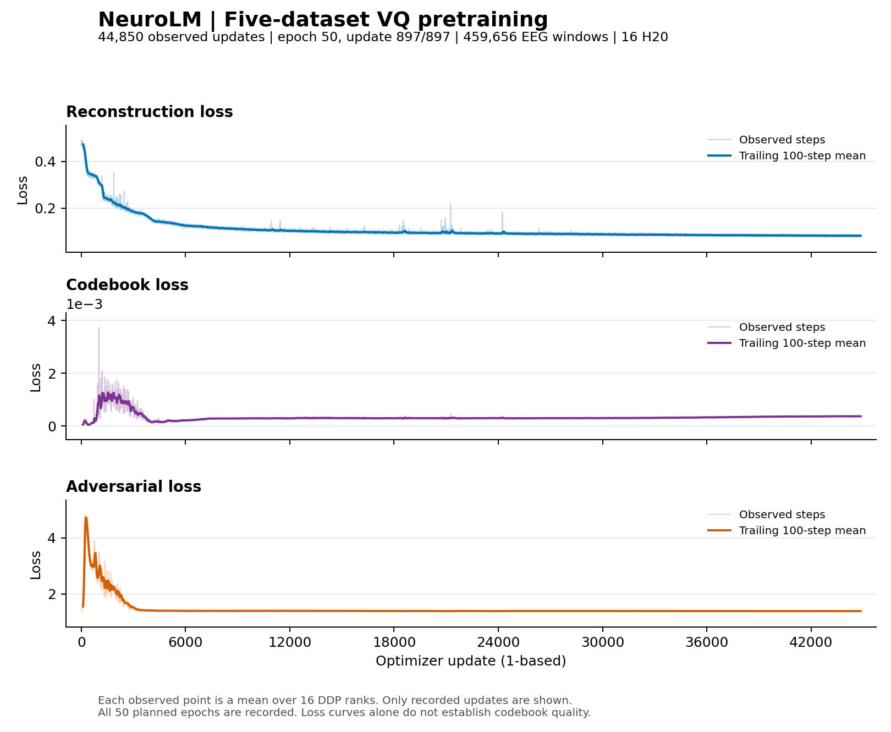

# 五数据集全量 VQ 训练结果

训练于北京时间 **2026-11-08 05:16** 完成，TI-ONE 实时查询状态为 **SUCCEED**。任务 `train-1712596817713834752` 完成 50/50 epochs、44,850 次优化器更新，两个节点退出码均为 0。训练循环完成，但持续的码本低使用率和固定诊断后期退化仍需处理，不能将平台成功解释为模型质量验收通过。

## Loss 与诊断

| 指标 | 第 1 epoch 轮均值 | 第 50 epoch 轮均值 |
| --- | ---: | ---: |
| 重建 loss | 0.372708 | 0.081716 |
| 码本 loss | 0.000153515 | 0.000366285 |
| 对抗 loss | 3.250297 | 1.384106 |

训练重建 loss 的轮均值下降 **78.1%**。三种 loss 全程有限；学习率在第 5 epoch 末达到 5e-5，最终约 1e-5。



- 最后 100 步仅使用 **179/8192 个码（2.19%）**，assignment perplexity 为 173.32。低使用率提示持续存在，loss 下降不能单独证明码本学习充分。
- 两个固定诊断样本的重建 loss 在第 **12** epoch 最低，为 **1.361598**；最终为 **2.152934**，比最佳诊断值上升 **58.1%**。这说明该固定诊断在后期退化；仅两个样本不足以推断全验证集表现或下游性能。
- 第 20–30 epoch 的训练 loss 仍在缓慢改善，但固定诊断没有同步改善。此前的检查标记只记录提示，不自动停止，所以本次按授权完成了 50 epochs。

## 检查点

最终权重位于腾讯 CFS：

```text
/mnt/cfs-omni/lhy/neurolm-reproduction/vq-five-full-20261107-r1/run/checkpoints/VQ/ckpt.pt
```

文件大小 1,734,777,699 字节，SHA256 为 `2de173f3bc3e78388e109fc32277b80dd5010bf562671d7469a47e99603ef183`。已在 CPU 成功加载，记录 epoch=49（从零计数）、iter_num=44850，encoder/decoder 层数 12/3，hidden 768；模型 state_dict 的 160 项均未发现非有限浮点值，包含优化器状态。

保留第 10、20、30、40、50 轮检查点，文件名分别为 `ckpt-9.pt`、`ckpt-19.pt`、`ckpt-29.pt`、`ckpt-39.pt`、`ckpt-49.pt`。**第 12 轮权重没有单独保留**；不能把最低诊断值等同于一个可取回的“最佳检查点”。后续可先比较现存检查点在有代表性的验证数据上的重建与码本使用情况。

本次使用五个数据集 train 划分的 459,656 个窗口，不是论文 25,000 小时语料。尚未评估这份新 VQ 权重的下游任务表现。

## 证据与监控状态

[最终结果 JSON](../results/vq_full_result_20261108.json) · [逐步日志](../results/vq_five_full_metrics_20261107.jsonl) · [逐轮日志](../results/vq_five_full_epochs_20261107.jsonl) · [曲线来源](../results/figures/vq-five-full-20261107-r1/curve_metadata.json) · [PDF](../results/figures/vq-five-full-20261107-r1/vq_training_curves.pdf)

tmux 的 `curves` 窗口在检测到完成标记后正常结束，并保留窗口；`train-log` 窗口仍可查看已完成日志。`monitor/latest.json` 是完成时快照，其中缓存的 API 状态可能仍显示 RUNNING，不能当作当前平台状态。本次新的 API 查询已确认 SUCCEED。
