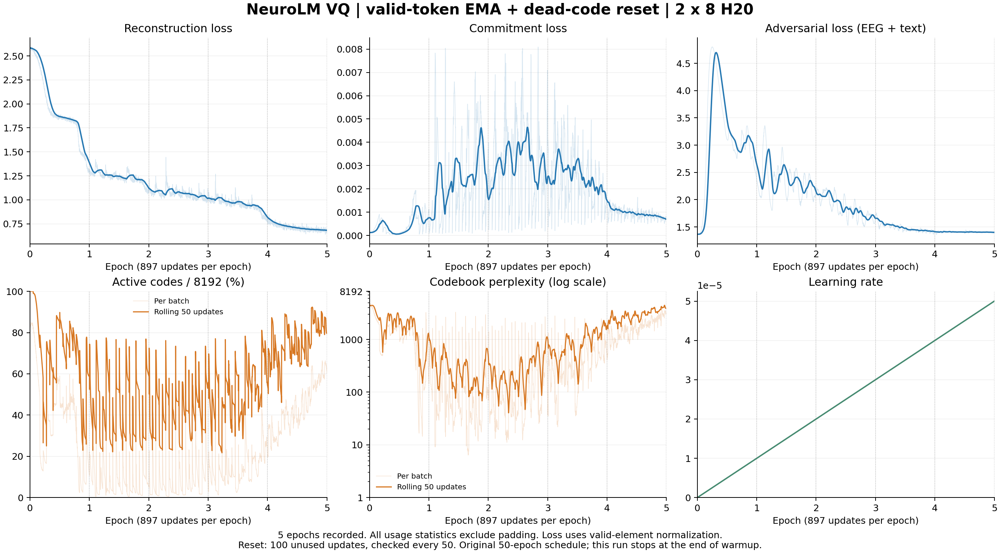
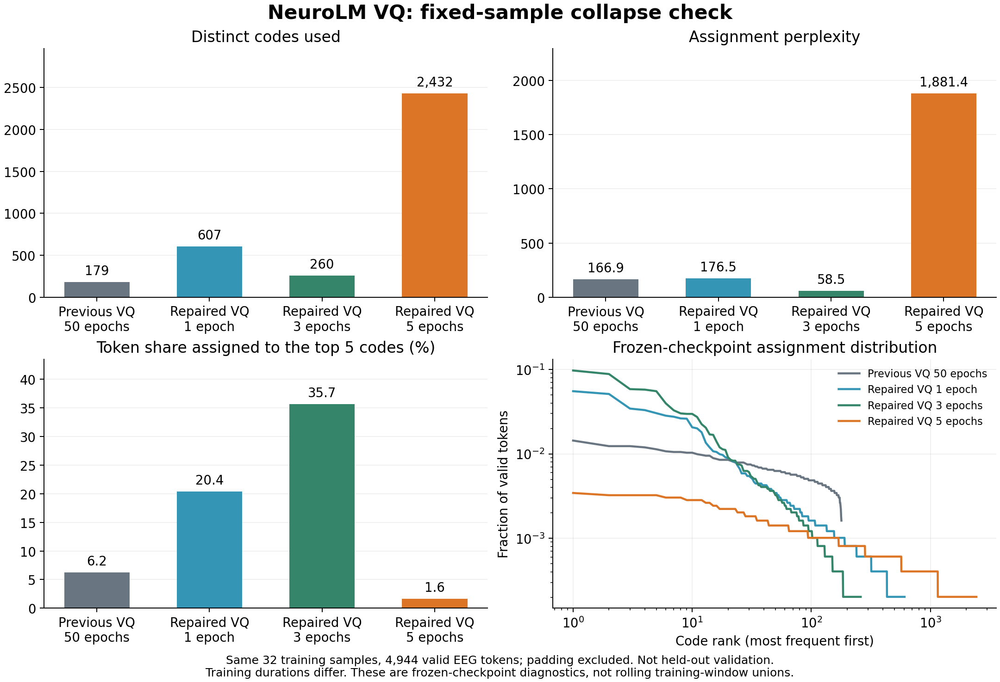

# 修复后 VQ：五个 epoch 稳定性检查

本次任务检验 padding 排除和死码重置能否在更长训练中持续维持有效码本；短程初始覆盖率升高不等于问题已经解决。模型从头初始化，不续接旧塌缩模型或 500 步的部分 epoch checkpoint。

## 运行记录

- TI-ONE 任务：`train-1713023249548061440`，名称 `neurolm-vq-fixed16-e5-20261108-r1`。
- 隔离目录：`/mnt/cfs-omni/lhy/neurolm-reproduction/vq-fixed-e5-20261108-r1`。
- 资源：两个工作节点，各 8 张 H20；开发机 SSH 入口不是工作节点地址。
- 启动前 Notebook STS 只读查询成功，请求 ID `f5f199ca-dee9-4c87-b29d-12368a91f8bc`，临时内核已清理。随后完成 preflight、dry-run、提交和 API 状态复查。
- 输入：五数据集训练划分，共 459,656 窗口；不包含验证或测试划分，也不是论文的 25,000 小时语料。
- `train_files.txt` SHA-256：`b3a2af72fd7a835286fd664fe9f791d4e31a4d434d04d15550aed8c42df18158`。
- 数据方案 SHA-256：`d83aba055dfc45a6b89cf1860ca8fad272fd68527a7866c3d3e11ea278bdbaa5`。
- 运行代码与已完成的 500 步 A/B 实验的 26 个文件完全一致；补丁见 `0017` 和 `0018`，`train_vq.py` SHA-256 为 `3f79a6c97111d1d20ffc9733736a11aafe81dd8e959e8aa08f3e0417a17c48c1`。

## 固定协议

encoder/decoder 12/3 层，hidden 768，码本 8192×128。每卡 EEG/text batch 为 32/8，全局 512/128，梯度累积为 1，种子 42。EMA decay 0.99、commitment β=1、连续 100 步未使用的码每 50 步检查并重置。候选池只包含有效 EEG token，各 rank 最多贡献 2048 个初始化样本。W&B 关闭。

保持原始 **50 epoch / 5 warmup epoch** 的学习率和对抗权重时间轴，通过 `--max_updates 4485` 在 **5 个完整 epoch** 后停止。每 epoch 897 次更新，保存每个 epoch 的 checkpoint。命令中的 `--epochs 50` 是调度长度，不代表本次运行 50 个 epoch。训练到第 5 个 epoch 末端时，学习率接近 5e-5；对抗权重约为 0.462。

## 观测与判读

`run/metrics.jsonl` 保存逐更新的重建、commitment、对抗 loss、学习率、有效码数、perplexity 和重置数量。`run/epoch_metrics.jsonl` 保存 epoch 汇总。`node-{0,1}/gpu_metrics.csv` 保存 GPU 采样。后台 `watch.py` 将进度写入 `monitor/latest.json`，每新增约 100 次更新生成 PNG/SVG/PDF 曲线。

所有码本统计排除 padding。单 batch、滚动 50 步和 epoch 末 100 步的计数窗口不同，不能混为同一使用率。旧训练的 179 个码是末 100 步指标，正式比较应使用同口径。重置后的码被分配到真实 token 才计入使用率，重置次数本身不计入活跃码数。

重点检查第 1、3、5 个 epoch 的末段使用率和 perplexity，而不是初始化时的覆盖率。重建 loss 使用有效元素归一化，不能直接与旧训练包含 padding 的 0.08 相比。保留旧口径辅助列 `reconstruction_padded_mean`。死码重置可能造成短期覆盖率峰值，因此同时检查重置周期内的低谷、分配集中度和重建质量。

用户最新明确要求：先用最终 VQ 从 GPT-2 初始化执行阶段二 100 步最小实验，再运行 1024×64、死码耐心 50 步的 VQ 五 epoch 对照。此顺序取代早期的条件执行计划。最小实验不等同于完整阶段二或下游效果验证。

## 复查入口

本地 `python scripts/check_vq_fixed_e5.py status` 通过 Notebook 临时身份查询平台状态；`scripts/inspect_vq_fixed_e5.py` 在腾讯开发机上只读检查 CFS 文件。`scripts/watch_vq_fixed_e5.py` 只读训练产物并生成曲线，不提交、停止或修改训练。

用户要求的 tmux 会话为 `vq-e5`，socket `/tmp/clawdbot-tmux-sockets/neurolm-vq-e5.sock`。连接命令：`ssh -t tencent "tmux -S /tmp/clawdbot-tmux-sockets/neurolm-vq-e5.sock attach -t vq-e5"`。此会话运行监控，训练由 TI-ONE 工作节点执行。完成后使用 `verify_vq_fixed_e5.py` 核验五个完整 epoch、16 个 rank 的输入记录和两节点退出码，并用 `audit_vq_fixed_e5.py` 在与旧诊断完全相同的 32 个训练样本上复测。

## 最终实测结果

平台状态 **SUCCEED**，两个节点退出码均为 0，完成 4485 次更新、5 个完整 epoch。最终权重为 `run/checkpoints/VQ/ckpt-4.pt`（epoch 从 0 计数）。16 个 rank 的输入记录、运行文件哈希和最终产物均已核验。

| epoch | 末 100 步重建均值 | commitment 均值 | 对抗均值 | 末 100 步活跃码并集 | 末 100 步 perplexity |
| --- | --- | --- | --- | --- | --- |
| 1 | 1.38844 | 0.000764 | 2.64836 | 6574 | 1248.05 |
| 2 | 1.12357 | 0.001574 | 2.14280 | 6403 | 758.44 |
| 3 | 1.01606 | 0.002523 | 1.65888 | 6449 | 1295.48 |
| 4 | 0.81891 | 0.001504 | 1.41219 | 7278 | 3030.37 |
| 5 | **0.68267** | **0.000704** | **1.40063** | **7630/8192** | **4489.99** |

第 5 epoch 末 100 步的单 batch 活跃码中位数 5057（最小 4568），perplexity 中位数 3054.29（最小 1804.46），单个最大码份额中位数 0.329%。早期分配集中在后段明显缓解。

同一组 32 个训练诊断样本、4944 个有效 token，冻结量化器重新评估：

| 权重 | 活跃码 | perplexity | 前 5 码份额 |
| --- | --- | --- | --- |
| 旧 50 epoch | 179 | 166.93 | 6.23% |
| 修复后 1 epoch | 607 | 176.49 | 20.41% |
| 修复后 3 epoch | 260 | 58.48 | 35.66% |
| 修复后 5 epoch | **2432** | **1881.44** | **1.64%** |

这组固定样本是训练诊断，不是独立验证集；不同训练时长也不能作为严格等预算比较。最终重建有效元素均值 0.68320。所有冻结审计均确认量化器状态未改变。

原始数据见 `results/vq_fixed_e5_20261108/`。结果归档 SHA-256：`ab86994ffbb711bc1852463291fe39d16a08b0b8396a20d04bb101d50ea55a2f`。不上传 EEG 原始样本、模型权重或凭证。
