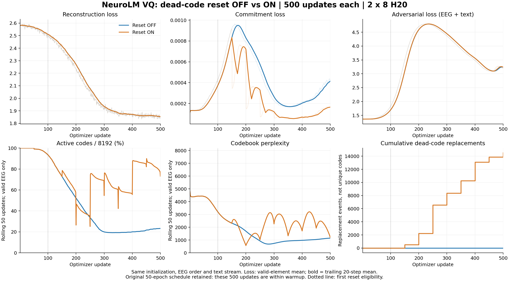

# VQ 死码重置：各 500 步的短程对照

用户于 2026-11-08 明确授权：使用之前两台各 8 张 H20，关闭/开启死码重置各运行 500 步，并打印 loss、码本使用率和 perplexity 对比曲线。

## 已完成结果

两组各完成 **500 次 optimizer update**；TI-ONE 最终回查为 **SUCCEED**，两个节点退出码均为 0。初始模型 SHA256 完全相同，16 个 rank 的 500 步 EEG 样本索引和文本位置全部逐项一致。重置前 99 步重建 loss 最大绝对差异为 `2.44e-6`。

下表中 loss 是第 451–500 步的均值；码本统计聚合相同 50 步的 **4,879,914 个有效 EEG token**，排除 padding。

| 指标 | 关闭重置 | 开启重置 |
|---|---:|---:|
| 重建 loss | 1.857253 | 1.857714 |
| 承诺 loss（原日志 codebook） | 0.0003702385 | 0.0001461145 |
| 对抗 loss，EEG + text | 3.175553 | 3.186953 |
| 总 loss | 5.033177 | 5.044812 |
| 活跃码 / 8192 | 1903 | 5994 |
| 码本使用率 | 23.23% | 73.17% |
| Perplexity | 1152.28 | 1200.76 |
| 累计重置次数 | 0 | 14511 |

**解释：**重置显著扩大了被使用过的码集合（+49.94 个百分点），承诺损失降低 60.54%；但聚合 perplexity 只增加 4.21%，重建 loss 增加 0.0248%，基本重合。曲线还显示重置组的 perplexity 有明显周期波动。当前证据支持“恢复了更多码的参与”，不支持“已经稳定解决塌缩”或“重建质量改善”。14511 是累计替换事件，可以重复替换同一码，不是独立码数。

仅看最后一个 batch：关闭/开启分别使用 1822/3640 个码，perplexity 为 1178.25/1331.40。因此 73.17% 是末 50 步窗口覆盖率，不是每个 batch 都有这么多码活跃。

两个固定诊断样本的最终重建 loss 为 2.90046/2.90319，也没有显示改善；样本数过小，不能当成泛化结论。两组最终学习率均为 `5.564228e-6`，对抗系数均为 `0.0555726`，仍在 4485 步 warmup 内。本次按要求停在 500 步，没有自动扩展训练。



曲线：[PNG](../results/figures/vq-reset-ab-500-20261108/vq_reset_ab_comparison.png) · [SVG](../results/figures/vq-reset-ab-500-20261108/vq_reset_ab_comparison.svg) · [PDF](../results/figures/vq-reset-ab-500-20261108/vq_reset_ab_comparison.pdf)

原始结果：[关闭重置 500 步日志](../results/vq_reset_ab_500_20261108/reset_off_metrics.jsonl) · [开启重置 500 步日志](../results/vq_reset_ab_500_20261108/reset_on_metrics.jsonl) · [完整性核验与统计](../results/vq_reset_ab_500_20261108/comparison_verified.json) · [最终 API 状态](../results/vq_reset_ab_500_20261108/final_api_status.json)。

## 固定条件

- 同一 TI-ONE 任务顺序运行两组，资源组 `rsg-b227f5pp`，2 × 8 H20；镜像 `kexin/pretrain:0.0.4`。
- 两组都使用补丁 0017 的有效 token 量化/EMA/损失修复，从零初始化，不加载旧 50 epoch checkpoint。
- 随机种子 42、encoder 12 层、decoder 3 层、hidden 768、码本 8192 × 128。
- 五数据集 459656 个训练窗口；每卡 EEG 32、text 8，全局 512/128。
- β=1、EMA decay=0.99；相同 AdamW 和数据预处理。
- 保留原 50 epoch、5 epoch warmup 的学习率和对抗系数调度，使用 `--max_updates 500` 严格截断。**500 步尚未到 warmup 峰值，不能据此判断长期收敛。**
- A：`--vq_dead_code_patience 0`；B：`--vq_dead_code_patience 100 --vq_dead_code_interval 50`。仅此实验开关和输出目录不同。

新增补丁 0018 支持固定更新数、每步有效码统计、滚动 50 步统计和输入流记录。文本使用独立 RNG，避免死码采样改变后续文本批次。结束后验证两个初始模型哈希一致、16 个 rank 的 500 步 EEG 索引和文本位置全部一致。

## 任务与产物

- 任务名：`neurolm-vq-reset-ab16-s500-20261108-r1`
- 任务 ID：`train-1712992456502544128`
- 服务器根目录：`/mnt/cfs-omni/lhy/neurolm-reproduction/vq-reset-ab-500-20261108-r1`
- 两组输出：`runs/reset_off/`、`runs/reset_on/`，各自保存 checkpoint、500 条 metrics 和 16 份输入序列记录。
- GPU 监控：`node-0/gpu_metrics.csv`、`node-1/gpu_metrics.csv`。
- 最终完整性判据：两个 `completed.json` 均报告 500 步、world size 16，`comparison_verified.json` 核对通过，两个节点正常退出，API 状态成功。

上述完成判据均已通过。checkpoint 分别保存在两个输出目录的 `checkpoints/VQ/ckpt.pt`，未覆盖原 50 epoch 产物。

## 曲线口径

重建、承诺和对抗 loss 使用有效 token 的新口径，显示原始数据与 trailing 20 步均值。码本使用率和 perplexity 使用滚动 50 步内的真实有效 EEG 分配，排除 padding，不把重置向量算作已使用。另保存每个 batch 的统计及累计替换次数，避免把短暂唤醒误认为稳定恢复。

这是一组固定 seed 的机制诊断，不提供多 seed 置信区间。固定两样本 probe 仅作辅助诊断，不替代独立验证集或下游任务评估。

两组顺序执行，数据缓存和共享文件系统延迟不同，因此不能用本次 wall-clock 差异评价死码重置的速度收益。

## 复查入口

```powershell
python scripts/check_vq_reset_ab.py status
Get-Content scripts/inspect_vq_reset_ab.py -Raw | ssh tencent '/usr/bin/python -'
```

提交前已完成新的 STS 实测、task spec dry-run、26 个运行文件哈希核对、459656 条数据索引核对和实际 VQ CPU 前向/反向回归测试。原完成运行和诊断副本均未覆盖。
