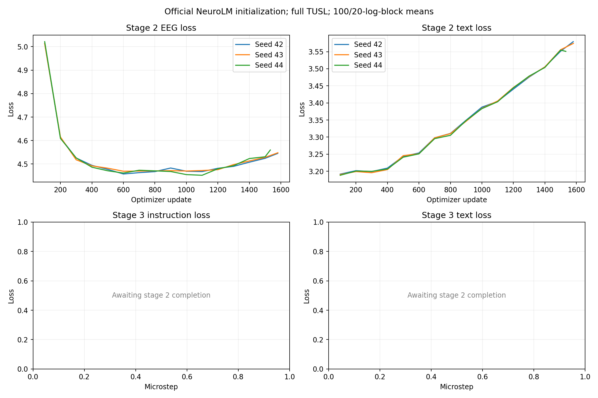
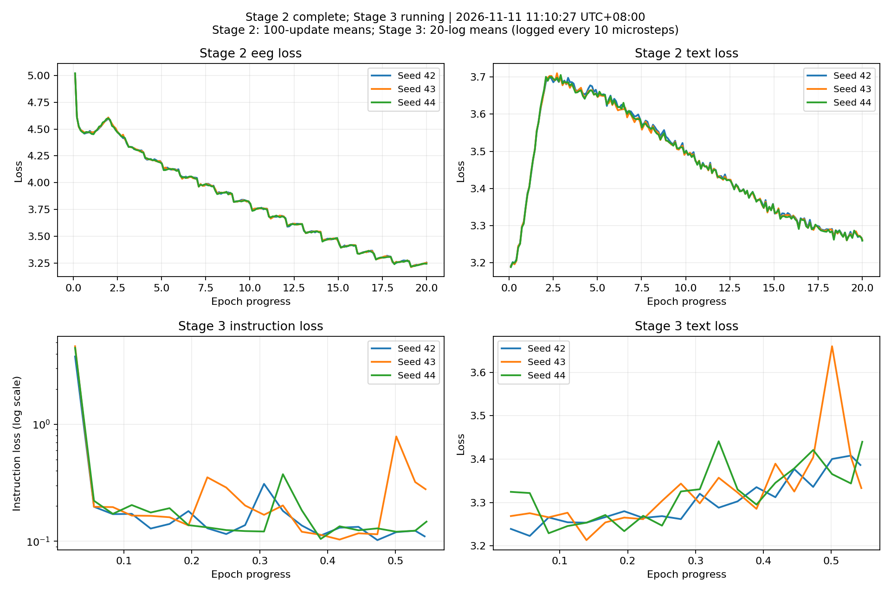
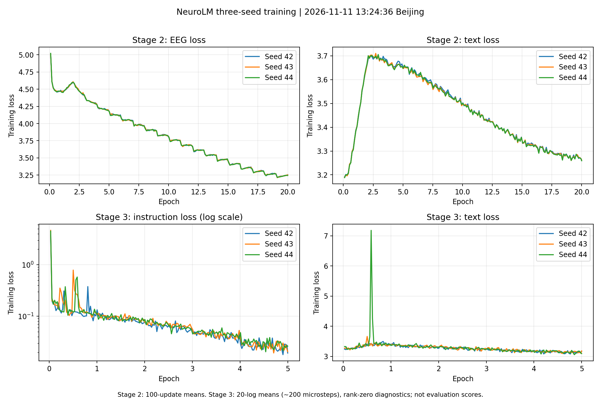

# Official NeuroLM initialization with complete TUSL coverage

This experiment continues pretraining from the author's released `NeuroLM-B.pt`, then performs five epochs of instruction tuning. Seeds 42, 43 and 44 have independent optimizers, samplers, outputs and TI-ONE tasks. Stage one is unchanged. This is a five-dataset experiment, not a reproduction of the paper's 25,000-hour pretraining corpus.

**Latest status, 2026-11-11:** all three full evaluations completed successfully. The subsequent [data audit](data_audit_20261111.md) identified a TUAB/TUEV preprocessing mismatch between stages and one TUSL patient identifier shared by validation/test. These limitations must accompany the scores below; successful execution and coverage audits do not establish patient-independent evaluation or consistent preprocessing.

## TUSL correction

| Split | EDF records | Old windows | Corrected windows |
| --- | ---: | ---: | ---: |
| Train | 67 | 119 | 174 |
| Validation | 23 | 66 | 66 |
| Test | 22 | 60 | 60 |
| Total | 112 | 245 | 300 |

All 112 source recordings and all 300 ten-second annotations are represented. Each class has 100 windows. The 245 existing REF windows retain exactly equal signal arrays. The recovered 24 LE recordings add 55 windows. Of the complete dataset, 259 windows have 23 channels and 41 have 21 channels, all with 2,000 samples at 200 Hz. The preprocessing uses 0.1–75 Hz filtering and a 60 Hz notch; stored values are µV, with division by 100 performed only by loaders.

Channel selection uses the author's 23-electrode set, taking the channels actually present. Additional channels outside this set, including OZ in the LE recordings and auxiliary channels, are enumerated in the remote provenance manifest. No channels are fabricated, and no EDF is discarded because it has fewer than 23 channels. LE and REF metadata are preserved; stripping the reference suffix for positional electrode IDs does not re-reference the signal. `TUSLLoader` now obtains electrode names from each pickle rather than assuming 23 channels.

The original sorted-file 60/20/20 split is retained. It is a file-level split and is not claimed to be patient-independent. Full raw provenance and sample files remain on the authorized servers.

## Checkpoints and training configuration

Official inputs under `/mnt/cfs-omni/lhy/neurolm-reproduction/checkpoints/`:

- `NeuroLM-B.pt`: SHA-256 `ffe098bc138b89f8817d3710a3604498d8ecd15135080e2ca27735d05c6d29ab`.
- `VQ.pt`: SHA-256 `e792c39a6a9e6d1bf4604cf63090730424f1d37f942597883d0c0a1375a2663a`.

Both hashes were verified in this session. All 90 EEG encoder tensors match exactly between the official files. Full NeuroLM state loading is strict, and every loaded tensor is checked against the official state. The official VQ has an encoder/decoder depth of 12/4; it is used as supplied. The existing VQ runtime has three additional nonlearned bookkeeping buffers, which are explicitly initialized to zero. All learned parameters must be present. VQ is frozen and in evaluation mode; no EMA or dead-code update occurs.

| Parameter | Stage 2 | Stage 3 |
| --- | --- | --- |
| Epochs | 20 | 5 |
| H20 GPUs per seed | 16, on two 8-GPU nodes | 2, on one node |
| Global EEG/text batch | 480 / 32 | 512 / 128 |
| Per-GPU EEG/text batch | 30 / 2 | 32 / 8 |
| Gradient accumulation | 1 | 8 |
| Peak/min learning rate | 6e-4 / 6e-5 | 5e-4 / 5e-5 |
| Warmup | 2 epochs | 10% of microsteps |
| Weight decay / clipping | 0.1 / 1 | 0.1 / 1 |
| EEG train windows | 459,711 | 459,711 |
| Updates | 19,140 | 4,490 |
| Microsteps per epoch | 957 | 7,182 |

Only existing training partitions enter stage two: TUAB 298,511; TUEV 68,270; HMC 91,248; Workload 1,508; TUSL 174. The four other datasets reuse verified immutable shards. Validation and test samples are excluded from pretraining. OpenWebText input is unchanged.

Training drops only the shuffled incomplete final minibatch, not any recording from the dataset. Stage two consumes 459,360 unique windows per epoch and stage three 459,648. Stage-three `DistributedSampler(drop_last=True, seed=args.seed)` keeps the actual loader length consistent with the author's floor-based learning-rate schedule; without it, this particular new dataset size would produce an extra padded microstep. The fixed dataset membership is identical across all three seeds.

Model source files retain their verified hashes. Changes are limited to explicit official checkpoint initialization, TUSL channel loading, seeded sampler/remainder handling, task orchestration and checks.

## Validation and operation

CPU checks passed for all 174 TUSL training windows. Both 21- and 23-channel pretraining samples produced finite EEG losses (6.2631 and 5.5839 respectively) with 210/230 valid tokens. Five-task instruction forward/backward checks were finite. A disposable optimizer update changed GPT weights while leaving the encoder and quantizer unchanged. These diagnostic values are not training results.

Remote experiment root:
`/mnt/cfs-omni/lhy/neurolm-reproduction/official-tusl3-20261111-r1`

Each seed uses `seed-N/stage2/` and `seed-N/stage3/`. The tmux driver submits the three stage-two jobs concurrently, then independently gates each stage-three submission on successful platform completion and a checkpoint audit. No automatic training restart is enabled. Failed/OOM/nonfinite jobs are reported without architecture changes.

From `ssh tencent`:

```bash
tmux -S /tmp/neurolm-tusl3-lhy/tmux.sock attach -t pretrain_neurolm_3seed
tmux -S /tmp/neurolm-tusl3-lhy/tmux.sock capture-pane -p -J -t pretrain_neurolm_3seed:0.0 -S -80
```

The driver's `pipeline_status.json` and `driver.log` contain current status. Stage-two worker logs are in `seed-N/stage2/run/pretrain.log`; stage-three logs are in `seed-N/stage3/worker.log`. `monitor/training_curves.png` and `monitor/progress.json` are refreshed by the driver.

After five instruction epochs, each seed is evaluated on all five validation/test sets (201,240 predictions per seed) with the same constrained decoder. An independent audit checks coverage, parsing and metrics. Final results will report each seed and mean ± sample standard deviation. Earlier one-epoch comparisons are historical context, not a matched control for this experiment.

Stage-two tasks were submitted on 2026-11-11 (Asia/Shanghai), and all three reached `RUNNING` and emitted finite training losses:

| Seed | TI-ONE task ID |
| --- | --- |
| 42 | `train-1715042690757953280` |
| 43 | `train-1715042690531460864` |
| 44 | `train-1715042690506959616` |

Seed 44 needed approximately 2 minutes 24 seconds to pull the worker image before starting. Early training evidence is a startup check, not a completed 20-epoch or five-epoch result. See the timestamped evidence exports for measured progress.

### Startup evidence: 2026-11-11 07:45:48 +08:00

All three jobs have completed one epoch and passed repeated frozen-state checks. The snapshot contains 1,663 / 1,663 / 1,617 logged updates for seeds 42 / 43 / 44. All recorded EEG losses, text losses and gradient norms are finite. Each job has 16 distinct H20 GPUs; the three jobs use 48 distinct GPUs in total. Recent GPU utilization averages are 96.95% / 96.47% / 96.68%.

EEG loss fell from about 5.9 at initialization to roughly 4.5–4.7. Text loss increased from about 3.2 to roughly 3.5–3.7 during the learning-rate warmup; this is explicitly visible in the curves and is not described as improvement. Final downstream quality remains unmeasured. Stage three has not started in this snapshot.

[Verified startup evidence](../results/official_tusl3_20261111/startup/health.json) · [Artifact hashes](../results/official_tusl3_20261111/startup/sha256.json)



### Stage two completed; downstream instruction training started

Fresh TI-ONE queries at 2026-11-11 11:10 +08:00 report all three stage-two tasks `SUCCEED` and all three stage-three tasks `RUNNING`. Each stage-two run completed exactly 20 epochs / 19,140 optimizer updates. Independent checkpoint checks passed: every model tensor is finite, the frozen encoder is unchanged, and GPT weights have updated.

| Seed | Final epoch EEG loss | Final epoch text loss | Stage-three task ID |
| --- | ---: | ---: | --- |
| 42 | 3.233950 | 3.273237 | `train-1715145841041344256` |
| 43 | 3.233643 | 3.273342 | `train-1715146431331576576` |
| 44 | 3.232064 | 3.271887 | `train-1715146740342729472` |

Stage-two final checkpoint SHA-256 values:

- Seed 42: `44b4d06f0649043f782b7555425a85d7ec6a601ef7458593a5a9bf53ce6c15ff`.
- Seed 43: `e1975c9c94155d0779e08c6c26adc10f150ea31dfe981096c6b1684ee9e06d9e`.
- Seed 44: `599cc0493fe65b5afc24fd7bf38bb0a83cf5269bd88814d86ed7066a07370096`.

Each downstream task passed strict checkpoint loading against its corresponding hash and includes all 174 TUSL training windows. The three five-epoch jobs now use two H20 GPUs each (six active GPUs total). The 11:10 snapshot records microsteps 3,900 / 3,910 / 3,920 out of 35,910, approximately 54% of the first epoch. Recent GPU utilization averages are 84.91% / 88.14% / 89.29%, with approximately 25.0 GiB allocated per device.

Instruction loss averaged over the last 20 logged observations is 0.1134 / 0.2719 / 0.1387. Observations are logged every ten microsteps and are rank-zero training diagnostics, not validation or test scores. Seed 43 currently has higher instruction loss; all logged losses remain finite. The common configuration is retained to complete the three-seed baseline. No downstream validation/test results have been produced yet, so no claim about improvement over the official model is made.

[Stage-transition snapshot](../results/official_tusl3_20261111/stage3_started/status.json) · [Checkpoint audits and evidence hashes](../results/official_tusl3_20261111/stage3_started/sha256.json)



### All instruction training completed; full evaluation in progress

At 2026-11-11 13:25:47 +08:00, all three stage-three checkpoints passed their independent checks: five completed epochs, 35,910 microsteps, 4,490 optimizer updates, finite model tensors, an unchanged frozen encoder, and updated GPT weights. Fresh TI-ONE queries still report `RUNNING` because the same tasks are now evaluating all five validation/test sets. The tmux driver remains alive. Full evaluation audits and final task success are still pending.

The complete training snapshot was captured at 13:24:36 +08:00. All logged instruction/text losses are finite. The table below averages the rank-zero observations recorded every ten microsteps; these are training diagnostics, not dataset-level evaluation scores.

| Seed | Epoch 1 instruction loss | Epoch 5 instruction loss | Epoch 5 text loss |
| --- | ---: | ---: | ---: |
| 42 | 0.241495 | 0.026790 | 3.140973 |
| 43 | 0.305498 | 0.027072 | 3.151684 |
| 44 | 0.286118 | 0.029367 | 3.145933 |

There were transient spikes during the first instruction epoch, including seed 44's text loss. The subsequent trajectory recovered; the curves retain these spikes rather than concealing them.

Stage-three checkpoint SHA-256 values:

- Seed 42: `695a845e87c6d2c0a731d01650815c6a272607a48a9ad3fdc8018866d7caf88e`.
- Seed 43: `b54b159ebb998fa86ce525a9a36c2bfad3ce96e734181ed1746cdad863fec3e2`.
- Seed 44: `61b14a915d668517db7d7ac74237b6157e298be3927b9650d98ce104f8ba524d`.

TUSL is the first completed evaluation task. Each seed includes all 66 validation and 60 test windows with zero parsing failures. These per-split metrics are provisional until the complete five-task independent evaluation audit finishes.

| Seed | TUSL validation balanced accuracy | TUSL test accuracy | TUSL test balanced accuracy | TUSL test weighted F1 |
| --- | ---: | ---: | ---: | ---: |
| 42 | 40.47% | 28.33% | 50.51% | 31.47% |
| 43 | 48.85% | 18.33% | 41.79% | 21.68% |
| 44 | 48.58% | 16.67% | 40.78% | 19.17% |

TUSL performance is poor despite decreasing training loss. The test split has class supports 33 / 3 / 24; the three models predict class 1 for 32 / 49 / 47 of 60 samples respectively. This observed prediction imbalance does not by itself establish its cause. No improvement over the official model is claimed, and test metrics are not used to select hyperparameters. The fixed three-seed baseline continues through the remaining four datasets before any validation-based tuning decision.

The six allocated H20 GPUs are transitioning from training to inference. The 13:25:47 snapshot's preceding-minute utilization was 0.00% / 1.32% / 15.77% by seed, with peak sampled memory 2.58 / 3.35 / 3.35 GiB per GPU. These are evaluation-transition measurements, not steady-state training throughput.

[Complete training curves and logs](../results/official_tusl3_20261111/stage3_trained/training_snapshot/status.json) · [Checkpoint audits, partial evaluation and GPU snapshot](../results/official_tusl3_20261111/stage3_trained/evaluation_started/evaluation_started.json)



### Full evaluation completed and data limitations verified

Fresh queries during the 2026-11-11 afternoon data audit report all three stage-three tasks `SUCCEED`. Each exited with code 0 and passed the independent five-task validation/test coverage and metric audit, with 201,240 predictions per seed. Results below use mean ± sample standard deviation across seeds 42/43/44.

| Task | Test balanced accuracy | Test weighted F1 |
| --- | ---: | ---: |
| TUAB | 76.99% ± 0.18 pp | 77.31% ± 0.10 pp |
| TUEV | 57.11% ± 2.60 pp | 77.69% ± 1.32 pp |
| HMC | 70.08% ± 0.91 pp | 73.04% ± 0.21 pp |
| Workload | 65.63% ± 4.59 pp | 64.81% ± 4.84 pp |
| TUSL | 44.36% ± 5.35 pp | 24.11% ± 6.50 pp |

The data audit checked every TUSL annotation/window/loader mapping and found no label, channel, normalization or padding mismatch. It also found that validation/test share one filename patient identifier, and 45/60 test windows belong to one patient identifier. Separately, all 120 sampled TUAB/TUEV training-window pairs differ between stages. Six original-EDF reconstructions exactly match stage-two signals with a 60 Hz notch and stage-three signals with a 50 Hz notch. These are concrete data limitations, not proof that they caused the earlier loss spike or all classification errors. No data, architecture or training configuration was modified during the audit.

[Final per-seed metrics, platform status and evaluation audits](../results/official_tusl3_20261111/data_audit/completed_evaluation.json) · [Data audit and correction priorities](data_audit_20261111.md)
