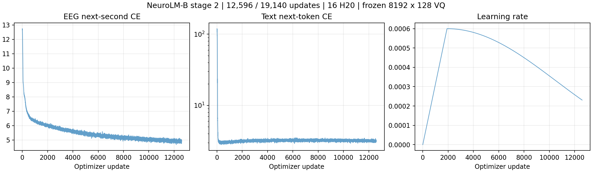

# NeuroLM-B 阶段二：20 epoch 全量预训练

文件名沿用用户指定的 `20261109`；实际提交日期为 **2026-11-08（Asia/Shanghai）**。本记录仅针对阶段二，不执行指令微调或下游指标评估。

## 任务与配置

- TI-ONE 任务：`train-1713134905275320064`，名称 `neurolm-pretrain-b16-e20-20261109-r1`。
- 运行根目录：`/mnt/cfs-omni/lhy/neurolm-reproduction/pretrain-full20-20261109-r1`。
- 资源：2 节点 × 8 H20，BF16，单卡 EEG/Text batch 30/2，全局 480/32，梯度累积 1。
- 20 epoch，每 epoch 957 次更新，共 19,140 次。每轮 shuffle，`drop_last=True`；459,656 个训练样本中每轮使用 459,360 个窗口。
- 学习率 6e-4 → 6e-5，cosine；warmup 2 epoch / 1,914 次更新；AdamW β=(0.9,0.95)，weight decay 0.1，grad clip 1，seed 42。
- W&B 与 compile 均关闭。平台自动重试次数 0。错误退出后不自动改代码或重新提交。
- 模型为 NeuroLM-B，GPT-2 初始化；并非完全随机初始化，也不从 100 步实验 checkpoint 续训。

参数已核对 [论文 Table 8，第 17 页](https://proceedings.iclr.cc/paper_files/paper/2025/file/8b4add8b0aa8749d80a34ca5d941c355-Paper-Conference.pdf)。配置文件见 [实验参数](../experiments/pretrain_full20_tione_20261109.json) 和 [启动脚本](../scripts/run_pretrain_full20.sh)。

## 数据与权重

训练集是此前经用户确认的五数据集训练窗口，共 459,656 个：TUAB 298,511，TUEV 68,270，HMC 91,248，Workload 1,508，TUSL 119。使用既有预训练格式 `X` / `ch_names` 的 indexed-tar 数据，不读取任务标签、指令样本或下游验证集。该规模**不等同于论文约 25,000 小时的预训练语料**。

实际训练清单为 `assets/train_files.txt`，SHA256 `b3a2af72fd7a835286fd664fe9f791d4e31a4d434d04d15550aed8c42df18158`。`assets` 复用 `vq-fixed-e5-20261108-r1/assets`，文本使用其既有 OpenWebText `text/train.bin`（18,071,164,978 bytes）。

VQ 权重为 `/mnt/cfs-omni/lhy/neurolm-reproduction/vq-fixed-e5-20261108-r1/run/checkpoints/VQ/ckpt-4.pt`，5 epoch 完成，8192×128，SHA256 `546e07e0b455b15ef9374a96bc77dead226bba8d00afa6e738a625fbb266de07`。通过 `--tokenizer_path` 显式传入；未使用 1024×64 对照权重。

GPT-2 来自 `openai-community/gpt2`，revision `607a30d783dfa663caf39e06633721c8d4cfcd7e`，`model.safetensors` SHA256 `248dfc3911869ec493c76e65bf2fcf7f615828b0254c12b473182f0f81d3a707`，离线加载。

VQ 输入编码器和产生目标 token 的 VQ 均 `requires_grad=False`，排除在 optimizer 外，保持 eval。每 100 次更新和每个 epoch 结束核对编码器与量化器哈希，并确认 GPT 权重已变化。

## 实现边界与启动前验证

以成功的 100 步实验运行包为基础（公开记录 commit `0f0a406`）。28 个文件中仅替换训练调度 helper `pretrain_minimal.py`，使其完成 20 个 epoch、逐 epoch 原子保存 checkpoint、记录冻结状态及训练统计。所有 `model/*`、`train_pretrain.py`、`train_vq.py` 与已验证运行包逐字节相同；未修改模型架构或 VQ 更新规则。

[源文件哈希清单](../results/pretrain_full20_source_manifest.json)、[构建脚本](../scripts/build_pretrain_full20.py)、[完整训练 helper](../scripts/pretrain_full20_runtime.py) 可用于重建。本次不加载原最小实验的 160 样本诊断验证集；仅记录训练自回归损失。

CPU 集成检查使用训练清单首个样本的裁剪副本、真实 VQ 和 GPT-2，验证下一秒目标、padding/末秒忽略、有限梯度、冻结权重不变及 GPT optimizer 更新。学习率计划亦验证为 19,140 次更新、1,914 warmup。提交前核对全部 28 个文件、数据分片存在性、权重与清单哈希。

作者扩展词表后的初始文本 CE 可超过 100；既有 100 步实验已验证其从约 117 降到约 3.2。初始幅度不能单独判作爆炸；本次以连续有限值、损失趋势和冻结状态检查实际健康状况。

## 15 分钟健康检查

**回查通过**，不是在第 15 分钟当场完成的检查。训练首次更新于 2026-11-08 16:14:50（北京时间），前 15 分钟覆盖 1,173 次更新：

| 检查 | 结果 |
| --- | --- |
| EEG CE，首/尾 20 步均值 | 12.5494 → 6.26518 |
| Text CE，首/尾 20 步均值 | 111.0966 → 3.10657 |
| loss、gradient norm、LR 有限值 | 全部通过 |
| 更新编号 | 连续 1–1173 |
| 冻结状态哈希检查 | 12/12 通过，GPT 权重已更新 |
| GPU | 两节点各 8 张均有采样 |
| 第 10–15 分钟单卡峰值显存范围 | 44,131–44,163 MiB |
| 第 10–15 分钟各卡平均利用率范围 | 83.9%–95.3% |

首次图表监控因容器创建的 `run` 目录对 SSH 用户不可写而失败；训练本身正常。仅将监控产物移到开发机用户可写的 `monitor` 目录，未改权限、训练代码或重启任务。2026-11-08 18:46:32（北京时间）根据完整时间戳日志与 GPU CSV 重建以上检查。详情见 [初始审计](../results/pretrain_full20_20261109/startup/monitor/first_15min_audit.json)。

本次导出的运行快照：已完成 13/20 epoch，第 12,596/19,140 步，平台 RUNNING。当前全部训练指标有限、VQ 冻结、GPT 更新正常。20 epoch 尚未完成。



21 项证据已按 [SHA256 清单](../results/pretrain_full20_20261109/startup/artifact_sha256.json)核验，归档 SHA256 `c78086e5a57ec00864fb33184fe976b621dd8963cddd70a972551e3b08bb8ebe`。

## 持续运行、日志和检查点

开发机的 `pretrain_neurolm` tmux 会话执行提交与只读监控；TI-ONE 实际工作节点运行 16 进程 DDP。训练不依赖本机 SSH 保持连接。

```bash
tmux -S /tmp/clawdbot-tmux-sockets/neurolm-pretrain-full.sock attach -t pretrain_neurolm
tmux -S /tmp/clawdbot-tmux-sockets/neurolm-pretrain-full.sock capture-pane -p -J -t pretrain_neurolm:0.0 -S -100
```

标准输出与错误汇总：`run/pretrain.log`；各节点另存 `node-0/worker.log`、`node-1/worker.log`。训练指标逐步写入 `run/metrics.jsonl`；曲线 `monitor/pretrain_curves.png`；GPU 每 5 秒采样；监控约每 60 秒刷新。

每个完整 epoch 原子覆盖 `run/checkpoints/NeuroLM-B/ckpt.pt`，保留最近一个完整 epoch，异常中断不覆盖此前完整 checkpoint。不实现自动断点恢复。最终以 `run/completed.json` 的 `epochs_completed=20`、`steps=19140` 和 TI-ONE `SUCCEED` 共同判定完成；监控将最终 checkpoint SHA256 写入 `monitor/final_checkpoint.json`。不自动启动阶段三。

## Git 提交

仅在初始健康检查通过后，将本次配置、脚本、真实日志快照和曲线推送到 GitHub `main`。根工作区已有未提交修改保持原样；本次使用独立 `codex/pretrain-full20-20261109` worktree。
