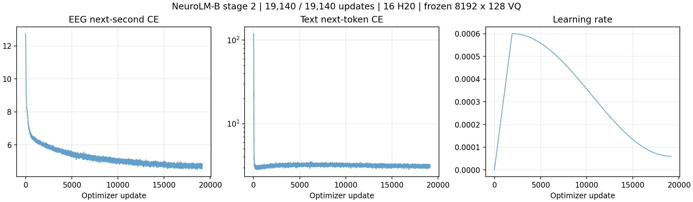
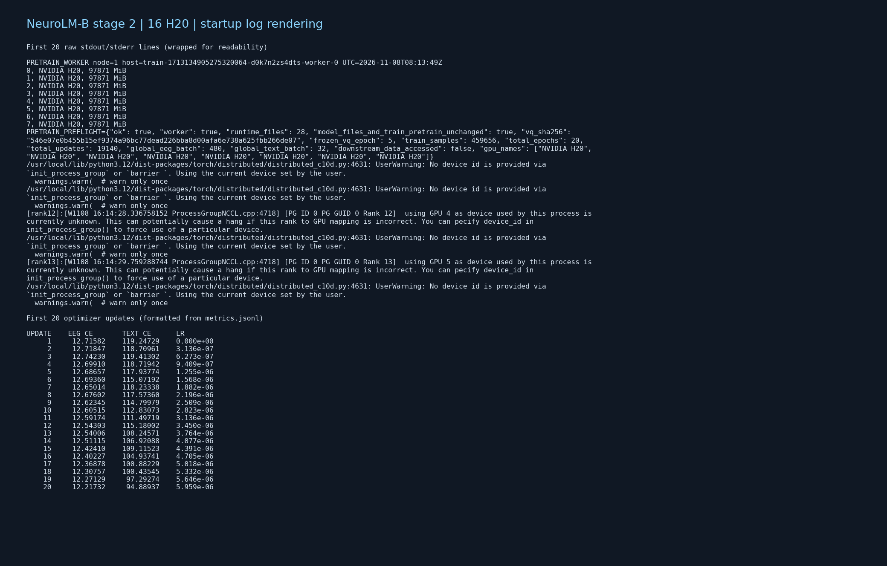

# 阶段二预训练启动与 tmux 记录

**2026-11-09 最终核验：20/20 epoch、19,140 次更新完成，TI-ONE `SUCCEED`，两节点退出码均为 0。** 训练于 2026-11-08 19:57:12（北京时间）完成，自首个更新起耗时 3 小时 42 分 22 秒。tmux 监控已结束并保留输出。

## 最终结果

以下均为阶段二自回归训练交叉熵的每轮均值，不是 VQ 重建损失，也不是下游任务指标。

| Epoch | EEG CE | Text CE |
| --- | ---: | ---: |
| 1 | 7.27315 | 6.66709 |
| 5 | 5.55142 | 3.21887 |
| 10 | 5.09475 | 3.23149 |
| 15 | 4.84613 | 3.15653 |
| 20 | **4.71969** | **3.11094** |

最后 100 步均值：EEG CE 4.71202，Text CE 3.11054。所有 19,140 步 loss、gradient norm 和学习率均有限；16 个 rank 的输入记录各有完整的 19,140 步。VQ 编码器和目标量化器全程冻结，GPT 权重已更新。EEG CE 从第 1 轮均值到第 20 轮下降 35.1%，后期仍缓慢下降；这一结果确认训练正常完成，不用于推断下游复现指标是否达标。本轮仅使用已授权的五数据集 459,656 个训练窗口，并非论文的 25,000 小时语料。



最终 checkpoint：

```text
/mnt/cfs-omni/lhy/neurolm-reproduction/pretrain-full20-20261109-r1/run/checkpoints/NeuroLM-B/ckpt.pt
```

- 文件大小：2,377,436,251 bytes（约 2.38 GB）。
- SHA256：`b13d1acdea4ed32fa1a3e6c7163c6fde6a03857eda131e36b10cc1380a3c5353`。
- 独立 CPU 读取确认 `epoch=19`（从 0 计数）、`iter_num=19140`、`epoch_complete=true`、VQ 8192×128；保存的所有模型张量有限。
- 从 checkpoint 重新计算冻结编码器哈希，与训练初始值一致；GPT block 哈希与最终训练记录一致且不同于初始值。

[最终独立审计](../results/pretrain_full20_20261109/final/monitor/final_audit_20261109.json) · [本次平台查询](../results/pretrain_full20_20261109/final/monitor/result_query_20261109.json) · [全部逐步指标](../results/pretrain_full20_20261109/final/run/metrics.jsonl) · [29 项证据哈希](../results/pretrain_full20_20261109/final/artifact_sha256.json)

最终归档 SHA256：`37b73c4bb32d140a046cdffb4b4bce3ba00706a3f2849d5d88a9041243535f0a`。`live_health.json` 的 `healthy_15min=false` 是因为任务已正常退出，该字段要求工作节点仍在运行；最终成功依据为平台状态、完成记录、两节点退出码与权重审计。未启动阶段三，也未进行下游评估。

## 启动与交接快照（历史）

2026-11-08 18:52:43（北京时间）交接时为 RUNNING，已完成 13/20 epoch、正在第 14 轮。本次接续已提交任务，未重复启动。首次更新为当天 16:14:50；当时日志尾部已到第 13,050 步。

- TI-ONE 任务：`train-1713134905275320064`，2 节点 × 8 H20。
- tmux：`pretrain_neurolm`，交接时 `pane_dead=0`、进程 `python`；最终监控完成后 `pane_dead=1`，输出保留。
- GPT-2 初始化，冻结新 VQ 编码器，训练 LLM 主体；VQ 和 GPT 均通过哈希检查确认各自冻结/更新行为。
- GPU 初始健康窗口中，每卡显存峰值约 43.1 GiB（44,131–44,163 MiB），各卡平均利用率 83.9%–95.3%。显存无需占满约 95.6 GiB 的卡容量；未以“显存满载”作为健康条件。

## 实际路径与参数

| 项目 | 实际值 |
| --- | --- |
| 运行根目录 | `/mnt/cfs-omni/lhy/neurolm-reproduction/pretrain-full20-20261109-r1` |
| 代码 | 根目录下 `code/train_pretrain.py` |
| VQ 权重 | `/mnt/cfs-omni/lhy/neurolm-reproduction/vq-fixed-e5-20261108-r1/run/checkpoints/VQ/ckpt-4.pt` |
| VQ 元数据 | 5 epoch 完成，8192×128；文件名 epoch 从 0 计数 |
| 数据 | 根目录下 `assets`，训练清单 `assets/train_files.txt`，459,656 个预训练窗口 |
| 新输出目录 | 根目录下 `run` |
| stdout/stderr | `run/pretrain.log`，另保留每节点日志 |
| EEG/Text batch | **参数为单卡 30/2；16 卡全局 480/32** |
| epochs / warmup | 20 / 2，共 19,140 次更新 |
| 学习率 | 6e-4 → 6e-5，cosine |
| AdamW | β=(0.9,0.95)，weight decay 0.1，grad clip 1.0 |
| 精度、日志 | BF16，W&B 关闭 |

VQ SHA256：`546e07e0b455b15ef9374a96bc77dead226bba8d00afa6e738a625fbb266de07`。所有 `model/*`、`train_pretrain.py` 与此前成功的 100 步运行包完全相同；本次仅扩展训练调度 helper 的轮数、检查点及监控。没有读取下游指令微调数据或评估下游指标。

## 实际启动方式

开发机 tmux 负责提交与持续监控，16 个 DDP 训练进程在 TI-ONE 工作节点执行。已运行的完整脚本为 [run_pretrain_full20.sh](../scripts/run_pretrain_full20.sh)，平台资源配置见 [JSON](../experiments/pretrain_full20_tione_20261109.json)。核心命令如下；`ROOT` 为上表运行根目录，节点地址与 rank 由平台注入。

```bash
OMP_NUM_THREADS=1 python3 -m torch.distributed.run \
  --nnodes=2 --nproc_per_node=8 \
  --master_addr="$MASTER_ADDR" --master_port="$MASTER_PORT" --node_rank="$RANK" \
  train_pretrain.py \
  --dataset_dir "$ROOT/assets" --train_manifest "$ROOT/assets/train_files.txt" \
  --data_ready_manifest "$ROOT/assets/data_ready.json" \
  --text_dir "$ROOT/assets/text" --out_dir "$ROOT/run" \
  --tokenizer_path /mnt/cfs-omni/lhy/neurolm-reproduction/vq-fixed-e5-20261108-r1/run/checkpoints/VQ/ckpt-4.pt \
  --gpt2_init_dir "$ROOT/gpt2" \
  --epochs 20 --warmup_epochs 2 --max_updates 19140 \
  --eeg_batch_size 30 --text_batch_size 2 --gradient_accumulation_steps 1 --num_workers 2 \
  --learning_rate 6e-4 --min_lr 6e-5 --weight_decay 0.1 \
  --beta1 0.9 --beta2 0.95 --grad_clip 1 --log_interval 10 --seed 42
```

## 健康检查与日志图

前 15 分钟 1,173 次更新全部有限，EEG CE 首尾 20 步均值 **12.5494 → 6.26518**，Text CE **111.0966 → 3.10657**，12 次冻结检查通过。高初始 Text CE 来自作者词表扩展，既有 100 步实验及本轮轨迹均显示其快速下降；EEG CE 约 12.7 起步。

检查是依据时间戳日志回查完成的：最初图表监控无权写容器生成的 `run` 目录，已将图表输出移至可写 `monitor` 目录。训练未因此中断，未改训练代码、权限或重新提交。详情和初始证据见 [完整记录](pretrain_pretrain_20261109.md)。

下面是从真实日志文本生成的开头图，**不是 GUI 截屏**；保留了原始日志文本以及最初 20 次训练更新。



[原始开头 20 行](../results/pretrain_full20_20261109/handoff/log_first20.txt) · [交接时末尾 20 行](../results/pretrain_full20_20261109/handoff/log_tail20.txt) · [本次运行状态](../results/pretrain_full20_20261109/handoff/handoff_status.json) · [证据哈希](../results/pretrain_full20_20261109/handoff/handoff_sha256.json)

## 查看与完成条件

在已配置 `tencent` SSH 的电脑登录后：

```bash
tmux -S /tmp/clawdbot-tmux-sockets/neurolm-pretrain-full.sock attach -t pretrain_neurolm
```

只读查看：

```bash
tmux -S /tmp/clawdbot-tmux-sockets/neurolm-pretrain-full.sock capture-pane -p -J -t pretrain_neurolm:0.0 -S -100
tail -20 /mnt/cfs-omni/lhy/neurolm-reproduction/pretrain-full20-20261109-r1/run/pretrain.log
```

该任务已完成 20 epoch，每轮原子保存 `run/checkpoints/NeuroLM-B/ckpt.pt`；当前文件为最终权重。tmux 监控已记录平台终态和最终 SHA256，保留会话用于查看输出；不会自动启动阶段三。

启动与健康证据已于 `de2bf95` / `bc8a6d6` 推送到 GitHub main；本页及交接证据在后续提交中补充。根工作区原有修改保持原样。
