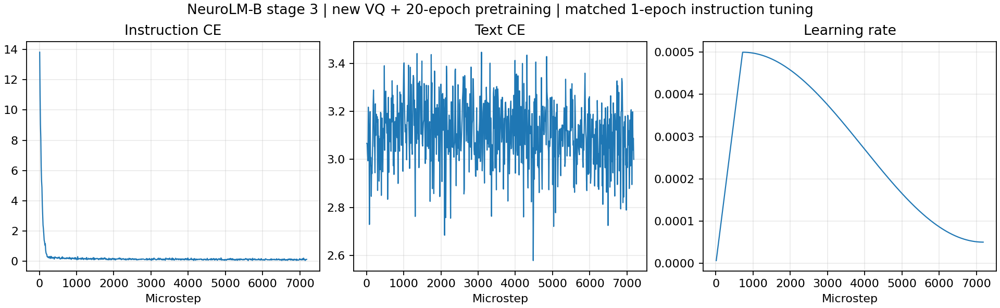

# 阶段三：新预训练模型与官方初始化的匹配比较

## 当前状态（2026-11-09，北京时间）

阶段二完成 20 epoch 后，新模型已完成阶段三的一轮指令微调，TI-ONE 任务 `train-1713786859836016384` 当前正在评估。**尚无本次完整对照结果，不能据训练 loss 宣称优于官方模型**。

13:51:44 的只读快照记录了第 510/7182 个 microstep：instruction CE 0.211357，text CE 3.151822，学习率 0.000354951。完整配置、启动日志、GPU 采样、CPU 检查和训练曲线见 [启动证据](../results/stage3_new_pretrain_20261109/startup/)。快照来自运行中的文件，不代表最终状态。

14:18 的完成检查确认：1 epoch、7,182 microstep、898 optimizer update，全部模型张量有限，冻结编码器 SHA 保持不变，GPT 权重已经更新。新 instruction checkpoint SHA-256 为 `39a53023b4d6b77b5264ec9d7461f202ab023938a0d9804ead493115a2bc50af`，大小 2,377,398,188 字节。完整路径为 `/mnt/cfs-omni/lhy/neurolm-reproduction/stage3-new-pretrain-20261109-r1/train/checkpoints/instruction-B/ckpt.pt`。

初步 TUSL test：60 例，accuracy 25.0%、balanced accuracy 27.1465%、非法答案 0。此时新模型其他任务及官方基线重评尚未结束，完整预测审计尚待执行。见[训练完成快照](../results/stage3_new_pretrain_20261109/trained/)，不要将其中的部分评估文件当作最终对照结果。



loss 是每 10 个 microstep 记录的 rank-0 microbatch 值，不是全数据集 epoch 均值；最后日志点是 7,180，实际完成步数 7,182 由 checkpoint 独立核验。

## 固定比较条件

本次复用此前官方初始化基线的 **五任务、1 epoch、seed 42、2 张 H20** 指令微调配置，仅替换完整预训练初始化。基线是已经完成相同指令微调的模型，不是未经指令微调的官方预训练权重。

| 项目 | 固定设置 |
| --- | --- |
| 任务 | TUAB、TUEV、HMC、Workload、TUSL；不包含 SEED |
| 训练数据 | 原有 train 划分共 459,656 窗口；DDP drop-last 实际使用 459,648 |
| EEG / text batch | 每卡 32 / 8，2 卡，累积 8；正常更新全局 512 / 128 |
| 最后一次更新 | 累积 6 个 microstep，全局 384 / 96 |
| 更新次数 | 7182 microstep，898 optimizer update |
| 学习率 | 5e-4 → 5e-5，warmup ratio 0.1，即 718 microstep |
| 优化器 | AdamW，betas 0.9 / 0.95，weight decay 0.1，grad clip 1 |
| 初始化 | 严格加载完整 stage-2 model state，使用新优化器，从 instruction epoch 0 开始 |
| 环境 | Python 3.11.8、PyTorch 2.2.2、CUDA 12.1、NumPy 1.26.4、BF16 |
| 日志 | stdout / 文件，W&B 关闭 |

学习率依照旧基线逐 microstep 更新，保留其原有语义。正的 warmup_steps 优先于 `warmup_epochs=1`。未改变模型结构、VQ 训练、优化器公式、训练数据顺序和损失计算。

完整模型携带的 EEG 编码器被恢复并冻结。`--tokenizer_path` 指向我们训练的 VQ；但 pretrained 分支实际加载的是完整 NeuroLM checkpoint 内嵌的编码器，不做未经对齐的事后编码器替换。

## 权重来源

以下路径前缀均为 `/mnt/cfs-omni/lhy/neurolm-reproduction/`。

| 用途 | 相对路径 | SHA-256 |
| --- | --- | --- |
| 新模型 stage-2 输入 | `pretrain-full20-20261109-r1/run/checkpoints/NeuroLM-B/ckpt.pt` | `b13d1acdea4ed32fa1a3e6c7163c6fde6a03857eda131e36b10cc1380a3c5353` |
| 官方原始预训练输入 | `checkpoints/NeuroLM-B.pt` | `ffe098bc138b89f8817d3710a3604498d8ecd15135080e2ca27735d05c6d29ab` |
| 既有官方初始化指令基线 | `outputs/neurolm-instruction-five-e1-2gpu-20261108-r2/checkpoints/instruction-B/ckpt.pt` | `a10a23f6f4a69058c996c01096d47b0806dafd83a0d0ca6506e274a5c6372174` |
| 我们的 VQ 来源 | `vq-fixed-e5-20261108-r1/run/checkpoints/VQ/ckpt-4.pt` | `546e07e0b455b15ef9374a96bc77dead226bba8d00afa6e738a625fbb266de07` |

Stage-2 输入已完成 20 epoch，epoch=19、iter=19140，全部模型张量有限；其详细结果见 [阶段二记录](pretrain_stage2_log.md)。新旧模型的 model_args 和全部 240 个 state tensor 形状一致。

## 评估与解释边界

训练完成后，当前任务依次评估新模型、既有官方初始化基线，均使用同一程序、两张 H20、BF16、每卡 batch 32、相同提示词、相同文件列表和选项约束解码。两模型分别覆盖五任务完整 val/test，共 **201,240 个窗口**；独立脚本复核唯一索引、覆盖范围、非法答案、准确率、balanced accuracy、weighted F1、kappa，二分类额外核对合法选项条件概率计算的 AUC。

| 任务 | val | test |
| --- | ---: | ---: |
| TUAB | 73,627 | 36,945 |
| TUEV | 15,662 | 28,305 |
| HMC | 22,124 | 23,871 |
| Workload | 290 | 290 |
| TUSL | 66 | 60 |

比较时优先同时看 accuracy 和 balanced accuracy，防止多数类猜测被误认为能力提升。旧的自由生成结果和“直接替换 VQ 编码器”的诊断结果不混入本次对照。不使用测试集挑选 checkpoint；固定一轮结束权重。

这是一次单 seed 的匹配实验，不是论文六任务、多 seed 的完整复现；TUSL test 只有 60 例。比较的是“我们的 VQ + 阶段二预训练”整体初始化与官方初始化，不能独立归因于某一个改动。预训练数据来自五数据集的训练划分，不是论文的 25,000 小时语料。

## 运行、核验与恢复查看

任务名：`neurolm-stage3-new-pretrain-e1-20261109-r1`。工作目录：`/mnt/cfs-omni/lhy/neurolm-reproduction/stage3-new-pretrain-20261109-r1`。训练输出为 `train/`；后续评估输出为 `eval-new/` 和 `eval-official/`。原始预测、EEG 和模型权重留在服务器；Git 只归档代码、配置、聚合结果、日志快照和证据哈希。

启动前通过了 12 项 evaluator 单元测试、全部划分计数核验、模型完整严格加载，以及五任务真实样本的有限 loss/合法答案检查。一次临时 CPU 参数更新验证了 GPT 可更新、冻结编码器不变；正式训练仍从原始 stage-2 输入开始。CPU 检查不是质量评估。

运行时复制已验证的 `code-eval-r4/author`（27 个文件），其中模型文件不改。仅在 `train_instruction.py` 添加 `--skip_evaluation`，训练保存权重后跳过旧的自由生成评估，改由外部审计过的约束解码器执行。修改前 SHA `d36d561dbb10802875695e47f30a80ae316fcf82c581aa50800feebd73107155`，修改后 SHA `fcc99299ec176958993af416a920a25501c0c8ca4c685cf2005a02784938b78b`。构建逻辑见 [build_stage3_runtime.py](../scripts/build_stage3_runtime.py)，完整命令见 [run_stage3_new.sh](../scripts/run_stage3_new.sh)。

tmux 在 Notebook 开发机维护提交与监控；实际计算由 TI-ONE 工作节点承担。连接 `tencent` 后执行：

```bash
tmux -S /tmp/clawdbot-tmux-sockets/neurolm-stage3.sock attach -t stage3_neurolm
tmux -S /tmp/clawdbot-tmux-sockets/neurolm-stage3.sock capture-pane -p -J -t stage3_neurolm:0.0 -S -100
```

任务关闭自动重启；训练或数据加载失败会退出并保留错误，不自动修改模型或重复训练。监控每 60 秒只读查询任务，终态先写入 `platform_final_status.json`，再绘图。
